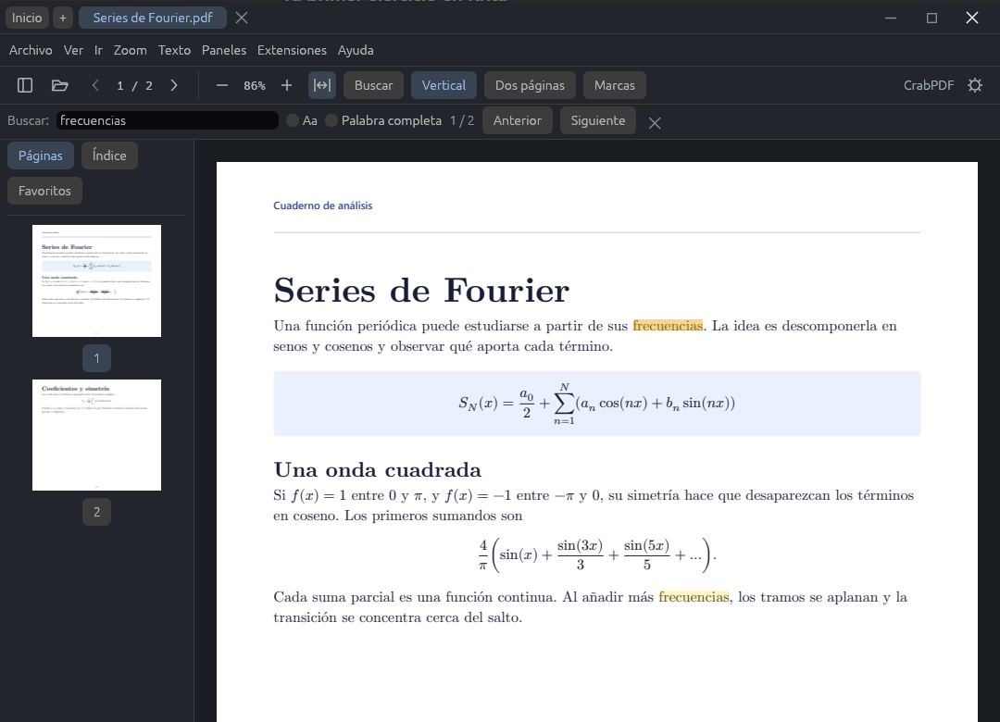

# CrabPDF

Lector de escritorio para PDF, libros electrónicos y cómics. Abre varios documentos en pestañas, marca pasajes y continúa la lectura desde tu equipo.

**[Descargar CrabPDF 0.6.0](https://mhalberto.github.io/crabpdf/#descargas)** · [Catálogo de extensiones](https://mhalberto.github.io/crabpdf/extensions/) · [Guía de uso](docs/USAGE.md)

## Descargar

| Sistema | Descargas de 0.6.0 |
| --- | --- |
| Windows 10 y 11 x64 | [Instalador](https://github.com/MHAlberto/crabpdf/releases/download/v0.6.0/crabpdf-0.6.0-win-x64-setup.exe) · [Portable](https://github.com/MHAlberto/crabpdf/releases/download/v0.6.0/crabpdf-0.6.0-win-x64.zip) |
| Windows x86 | [Instalador](https://github.com/MHAlberto/crabpdf/releases/download/v0.6.0/crabpdf-0.6.0-win-x86-setup.exe) · [Portable](https://github.com/MHAlberto/crabpdf/releases/download/v0.6.0/crabpdf-0.6.0-win-x86.zip) |
| Ubuntu 24.04 x64 y Linux x64 | [DEB](https://github.com/MHAlberto/crabpdf/releases/download/v0.6.0/crabpdf-0.6.0-ubuntu24.04-amd64.deb) · [TAR.GZ para glibc 2.36+](https://github.com/MHAlberto/crabpdf/releases/download/v0.6.0/crabpdf-0.6.0-linux-x64.tar.gz) |
| macOS 15+ con Apple Silicon | [DMG](https://github.com/MHAlberto/crabpdf/releases/download/v0.6.0/crabpdf-0.6.0-mac-arm64.dmg) · [ZIP](https://github.com/MHAlberto/crabpdf/releases/download/v0.6.0/crabpdf-0.6.0-mac-arm64.zip) |
| macOS 15+ con Intel | [DMG](https://github.com/MHAlberto/crabpdf/releases/download/v0.6.0/crabpdf-0.6.0-mac-x64.dmg) · [ZIP](https://github.com/MHAlberto/crabpdf/releases/download/v0.6.0/crabpdf-0.6.0-mac-x64.zip) |

[Notas de 0.6.0](docs/releases/v0.6.0.md) · [Sumas SHA-256](https://github.com/MHAlberto/crabpdf/releases/download/v0.6.0/SHA256SUMS-v0.6.0.txt) · [Procedencia de los paquetes](docs/releases/v0.6.0-publication.json)

Los instaladores de Windows se publican sin firma digital. Los paquetes de macOS llevan firma ad hoc y se distribuyen sin notarización. La interfaz se comprobó en Windows 10 x64, Ubuntu 24.04 y macOS 15. El ejecutable Windows x86 se comprobó bajo WOW64. [Pruebas y alcance por plataforma](docs/VALIDATION.md).

## Lectura y anotaciones

- Busca en el texto o salta a un capítulo desde el índice. Elige lectura continua, dos páginas, modo libro o pantalla completa.
- Resalta y subraya. Copia selecciones entre páginas y guarda una copia del PDF con tus marcas.
- Guarda favoritos, consulta recientes y retoma la posición de cada documento. Al restaurar una sesión se abre primero la pestaña activa.
- Además de PDF, abre EPUB, Kindle sin DRM, DjVu, XPS, CHM y cómics. [Formatos y límites](docs/FORMATS_AND_ANNOTATIONS.md).

## Extensiones

Abre **Extensiones → Gestor de extensiones → Catálogo**, escribe el código y pulsa **Buscar**. Activa el paquete después de instalarlo.

| Código | Extensión |
| --- | --- |
| `100002` | OCR de ecuaciones. Convierte una región del PDF a LaTeX con un modelo que se descarga por separado. |
| `100003` | Pomodoro. Temporizador con avisos en el lector. |
| `100001` | Información de la selección. Ejemplo de la API de extensiones. |

[Catálogo y compatibilidad](https://mhalberto.github.io/crabpdf/extensions/) · [Crear una extensión en Rust](docs/EXTENSIONS.md)

## Desarrollo

El lector y la API se desarrollan en Rust. La interfaz usa egui/eframe y la lectura de PDF usa PDFium. La web usa HTML, CSS y JavaScript nativos.

- [Compilar CrabPDF](docs/DEVELOPMENT.md) · [Arquitectura](docs/ARCHITECTURE.md) · [Contribuir](CONTRIBUTING.md)
- [Rendimiento](docs/PERFORMANCE.md) · [Pruebas](docs/VALIDATION.md) · [Plan hacia 1.0](docs/V1_PLAN.md)
- [Construir la web](docs/WEBSITE.md)

El código se distribuye bajo [MIT](LICENSE). Los motores y conversores conservan sus [licencias y avisos](docs/THIRD_PARTY_NOTICES.md).
