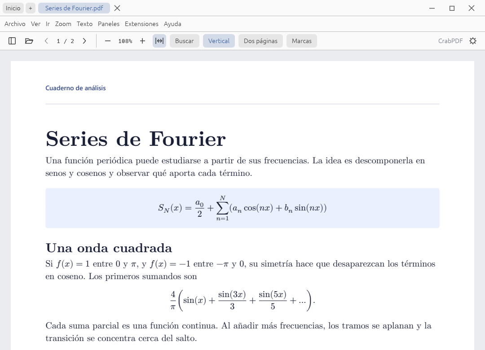
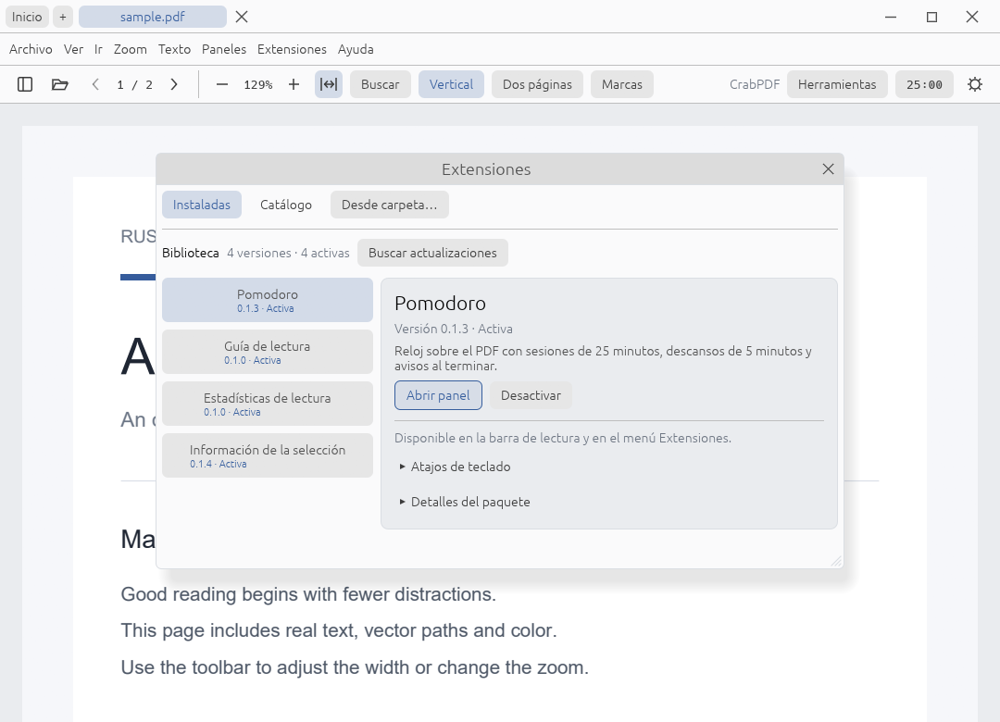

# CrabPDF

Lector de escritorio para PDF, libros electrónicos y cómics. Abre varios documentos en pestañas, marca pasajes y continúa la lectura desde tu equipo.

**[Descargar CrabPDF 0.8.1](https://mhalberto.github.io/crabpdf/#descargas)** · [Catálogo de extensiones](https://mhalberto.github.io/crabpdf/extensions/) · [Guía de uso](docs/USAGE.md)

## Descargar

| Sistema | Descargas de 0.8.1 |
| --- | --- |
| Windows 10 y 11 x64 | [Instalador](https://github.com/MHAlberto/crabpdf/releases/download/v0.8.1/crabpdf-0.8.1-win-x64-setup.exe) · [Portable](https://github.com/MHAlberto/crabpdf/releases/download/v0.8.1/crabpdf-0.8.1-win-x64.zip) |
| Windows x86 | [Instalador](https://github.com/MHAlberto/crabpdf/releases/download/v0.8.1/crabpdf-0.8.1-win-x86-setup.exe) · [Portable](https://github.com/MHAlberto/crabpdf/releases/download/v0.8.1/crabpdf-0.8.1-win-x86.zip) |
| Ubuntu 24.04 x64 y Linux x64 | [DEB](https://github.com/MHAlberto/crabpdf/releases/download/v0.8.1/crabpdf-0.8.1-ubuntu24.04-amd64.deb) · [TAR.GZ para glibc 2.36+](https://github.com/MHAlberto/crabpdf/releases/download/v0.8.1/crabpdf-0.8.1-linux-x64.tar.gz) |
| macOS 15.0+ con Apple Silicon | [DMG](https://github.com/MHAlberto/crabpdf/releases/download/v0.8.1/crabpdf-0.8.1-mac-arm64.dmg) · [ZIP](https://github.com/MHAlberto/crabpdf/releases/download/v0.8.1/crabpdf-0.8.1-mac-arm64.zip) |
| macOS 15.0+ con Intel | [DMG](https://github.com/MHAlberto/crabpdf/releases/download/v0.8.1/crabpdf-0.8.1-mac-x64.dmg) · [ZIP](https://github.com/MHAlberto/crabpdf/releases/download/v0.8.1/crabpdf-0.8.1-mac-x64.zip) |

[Notas de 0.8.1](docs/releases/v0.8.1.md) · [Sumas SHA-256](https://github.com/MHAlberto/crabpdf/releases/download/v0.8.1/SHA256SUMS-v0.8.1.txt) · [Procedencia de los paquetes](docs/releases/v0.8.1-publication.json)

Los instaladores de Windows se publican sin firma digital. Los paquetes de macOS llevan firma ad hoc y se distribuyen sin notarización. La interfaz se comprobó en Windows 10 x64, Ubuntu 24.04 y macOS 15. El ejecutable Windows x86 se comprobó bajo WOW64. [Pruebas y alcance por plataforma](docs/VALIDATION.md).

## Lectura y anotaciones

- Busca en el texto o salta a un capítulo desde el índice. Elige lectura continua, dos páginas, modo libro o pantalla completa.
- Resalta y subraya. Copia selecciones entre páginas y guarda una copia del PDF con tus marcas.
- Guarda favoritos, consulta recientes y retoma la posición de cada documento. Al restaurar una sesión se abre primero la pestaña activa.
- Además de PDF, abre EPUB, Kindle sin DRM, DjVu, XPS, CHM y cómics. [Formatos y límites](docs/FORMATS_AND_ANNOTATIONS.md).

## Extensiones

Abre **Extensiones → Gestor de extensiones → Catálogo**, escribe el código y consulta su ficha. Activa el paquete después de instalarlo y abre su panel desde **Herramientas** en la barra de lectura.

| Código | Extensión |
| --- | --- |
| `100002` | OCR de ecuaciones. Convierte una región del PDF a LaTeX con un modelo que se descarga por separado. |
| `100003` | Pomodoro. Reloj en la barra de lectura con controles en el panel lateral. |
| `100001` | Información de la selección. Ejemplo de la API de extensiones. |
| `100004` | OCR de texto. Reconoce una región escaneada con Tesseract. |
| `100005` | Estadísticas de lectura. Tiempo en primer plano, visitas a páginas y enfoques completados. |
| `100006` | Guía de lectura. Franja de posición y altura ajustables en el visor. |

[Catálogo y compatibilidad](https://mhalberto.github.io/crabpdf/extensions/) · [Crear una extensión en Rust](docs/EXTENSIONS.md)

## Desarrollo

La versión 0.8.1 integra las herramientas en el visor y añade Estadísticas y Guía de lectura. [Cambios de 0.8.1](docs/releases/v0.8.1.md) · [Captura de Pomodoro](docs/screenshots/0.8.1-pomodoro.png).

El lector y la API se desarrollan en Rust. La interfaz usa egui/eframe y la lectura de PDF usa PDFium. La web usa HTML, CSS y JavaScript nativos.

- [Compilar CrabPDF](docs/DEVELOPMENT.md) · [Arquitectura](docs/ARCHITECTURE.md) · [Contribuir](CONTRIBUTING.md)
- [Rendimiento](docs/PERFORMANCE.md) · [Pruebas](docs/VALIDATION.md) · [Plan hacia 1.0](docs/V1_PLAN.md)
- [Construir la web](docs/WEBSITE.md)

El código se distribuye bajo [MIT](LICENSE). Los motores y conversores conservan sus [licencias y avisos](docs/THIRD_PARTY_NOTICES.md).
