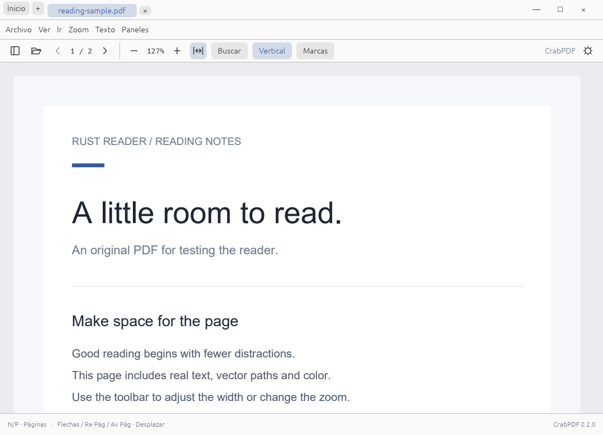

# CrabPDF

Lector local de documentos desarrollado en Rust con egui/eframe y PDFium. Tiene identidad visual propia, sin cuentas, telemetría ni conexión obligatoria.

El icono nativo procede de `assets/crabpdf-logo.svg`, con fondo transparente. `build.rs` genera el PNG de la ventana y, en Windows, incrusta un ICO con nueve tamaños de 16 a 256 píxeles y las propiedades CrabPDF en `crabpdf.exe`. No se necesita el SVG junto al ejecutable.

La meta de **v1.0** es reproducir todas las funciones y detalles visibles de la revisión fijada de SumatraPDF en Windows x86/x64, Linux y macOS. La implementación está marcada como **0.4.1 en desarrollo**: la paridad completa todavía no está alcanzada. [Alcance y pendientes](docs/ROADMAP.md).

Descarga [CrabPDF 0.4.0](https://github.com/MHAlberto/crabpdf/releases/tag/v0.4.0):

- Windows: [instalador x64](https://github.com/MHAlberto/crabpdf/releases/download/v0.4.0/crabpdf-0.4.0-win-x64-setup.exe) · [instalador x86](https://github.com/MHAlberto/crabpdf/releases/download/v0.4.0/crabpdf-0.4.0-win-x86-setup.exe).
- Linux: [Ubuntu 24.04 DEB](https://github.com/MHAlberto/crabpdf/releases/download/v0.4.0/crabpdf-0.4.0-ubuntu24.04-amd64.deb) · [Linux x64 TAR](https://github.com/MHAlberto/crabpdf/releases/download/v0.4.0/crabpdf-0.4.0-linux-x64.tar.gz).
- Portables, fuentes y SHA-256: [todos los archivos de la entrega](https://github.com/MHAlberto/crabpdf/releases/tag/v0.4.0).

La compilación local **0.4.1** corrige el arrastre y la alineación de la barra, incorpora F6 para invertir colores y reduce copias y trabajo por frame. [Cambios de 0.4.1](docs/releases/v0.4.1.md) · [Revisión de rendimiento](docs/PERFORMANCE.md). Las descargas públicas anteriores permanecen en 0.4.0.

La entrega [0.4.0](docs/RELEASE_0_4_0.md) reúne la migración modular, las mejoras de lectura y los instaladores Windows. [Notas de la versión](docs/releases/v0.4.0.md).

Para continuar el desarrollo: [pantalla completa, favoritos y arrastre en 0.3.6](docs/IMPLEMENTATION_PROGRESS_0_3_6.md), [navegación e interfaz en 0.3.5](docs/IMPLEMENTATION_PROGRESS_0_3_5.md), [punto de lectura y manga en 0.3.4](docs/IMPLEMENTATION_PROGRESS_0_3_4.md), [pantalla completa y teclado en 0.3.3](docs/IMPLEMENTATION_PROGRESS_0_3_3.md), [avance de 0.3.2](docs/IMPLEMENTATION_PROGRESS_0_3_2.md), [recuperación de caché en 0.3.1](docs/IMPLEMENTATION_PROGRESS_0_3_1.md), [entrega 0.3.0](docs/IMPLEMENTATION_PROGRESS.md), [auditoría de la base 0.2](docs/AUDIT_V1.md), [rutas y criterios para 1.0](docs/V1_PLAN.md), [backlog con dependencias](docs/V1_BACKLOG.csv) y [guía de agentes](AGENTS.md).



[Interfaz oscura](docs/screenshots/dark.png).

[Biblioteca de documentos](docs/screenshots/library.png).

[Resaltado de palabras](docs/screenshots/highlight.png) y [biblioteca con libros y cómics](docs/screenshots/library-formats.png).

## Estructura del código

El repositorio usa un workspace Rust: `crates/core` contiene los tipos y la geometría; `crates/application`, las reglas de lectura y el perfil; `crates/runtime`, los trabajadores, PDFium, importadores y almacenamiento. `src/desktop` conecta servicios nativos y `src/ui` contiene la interfaz. Los recursos están en `assets/` y los documentos de prueba en `tests/fixtures/`.

La lógica interna se comprueba con `cargo test -p crabpdf-core -p crabpdf-application --locked`, sin biblioteca PDFium ni ventana. Para comprobar todos los paquetes usa `cargo test --workspace --locked` y `cargo clippy --workspace --all-targets --locked -- -D warnings`. Las pruebas nativas omitidas requieren preparar PDFium y los conversores como se explica abajo.

[Arquitectura actual](docs/ARCHITECTURE.md) · [Migración y evidencia](docs/architecture/PHASE_6.md). PDFium y los conversores siguen siendo componentes nativos; existe un pequeño puente de metadatos de MuPDF. La reorganización no implica un motor íntegramente Rust ni completa la paridad 1.0.

## Funciones implementadas

- Apertura múltiple, arrastrar archivos, pestañas, duplicar, ordenar, cerrar otras/izquierda/derecha y reabrir.
- PDF, EPUB, MOBI/Kindle sin DRM, FictionBook, XPS, DjVu, CHM, cómics ZIP/RAR/7z/TAR, imágenes, texto y Markdown. [Extensiones y límites](docs/FORMATS_AND_ANNOTATIONS.md).
- Pestañas en la barra superior, Inicio permanente y biblioteca de recientes/frecuentes con portadas y caché persistente.
- Lectura de una página, páginas enfrentadas, libro, continuo y orden manga.
- Modo vertical ajustado al ancho, precarga de páginas vecinas y vista temporal mientras llegan los tiles nítidos.
- Primera/última página, salto por número e historial de navegación.
- Desplazamiento continuo al mantener las flechas, marcado sin vaciar la página, viewport estable sin pie inferior y opción Reducir movimiento. [Correcciones y mediciones](docs/INTERACTION_FIXES.md).
- Marcas con muestras compactas de color y cruces vectoriales de ventana/pestañas con áreas de clic mayores.
- Zoom de 8–6400 %, personalizado, tamaño real y ajuste a página, ancho o alto.
- Ctrl+rueda y conservación de la región al hacer zoom; bitmaps alineados con píxeles físicos.
- Rotación, pan, desplazamiento por teclado y renderizado HiDPI por regiones visibles.
- Miniaturas reales, índice PDF y favoritos del libro abierto, ordenados por página, con guardar/quitar y eliminación individual sin mezclar otros documentos.
- Arrastrar una pestaña fuera de la barra y soltar abre el libro en otra ventana, conservando página, zoom y punto de lectura; volver a la barra o Escape cancela.
- Selección de texto con ratón, doble clic, seleccionar página y copiar cuando los permisos PDF lo permiten.
- Resaltado y subrayado con amarillo, verde, azul, rosa, naranja, rojo o un color personalizado; persistencia local, deshacer y exportación de anotaciones reales a PDF.
- Búsqueda progresiva, mayúsculas/palabra completa, resaltado y desplazamiento al resultado.
- Enlaces PDF internos y externos; metadatos y propiedades.
- Contraseña con reintento/cancelación; no se guarda la contraseña.
- Guardar una copia del PDF con escritura temporal y reemplazo final.
- Menús, contexto, paleta de comandos, pantalla completa, presentación y controles ocultables.
- Paleta con flechas/Enter/Escape y atajos visibles; F11 oculta las barras y reduce márgenes. Los controles aparecen al acercar el puntero al borde superior; F5 conserva la presentación con fondo negro.
- Temas claro/oscuro, inversión y grises del documento.
- Recientes, punto de lectura relativo a página, manga/modo/zoom por documento, favoritos y restauración opcional de sesión en TOML.
- Parámetros CLI para varios documentos, página, zoom, modo, rotación, búsqueda y presentación.

Estas funciones tienen diferencias pendientes frente a SumatraPDF; no se declaran en paridad completa. La selección es de una página. Faltan, entre otros, impresión, edición general de anotaciones/formularios, formatos avanzados, SyncTeX y accesibilidad completa. [Inventario](docs/parity/commands.csv).

Para marcar palabras, selecciona con doble clic o arrastrando y abre **Marcas**. Ctrl/⌘ + Mayús + L resalta, Ctrl/⌘ + Mayús + U subraya y Ctrl/⌘ + Z deshace la última marca. Las marcas reaparecen al abrir el mismo archivo en CrabPDF; **Guardar una copia** las incluye en un PDF para compartir. Si un libro antiguo carece de firma de paginación o se convirtió de otra manera, sus marcas se conservan y aparece un aviso en vez de aplicarlas al texto equivocado.

Los paquetes de Windows incluyen `format-tools/`: conserva esa carpeta y `pdfium.dll` junto a `crabpdf.exe`. Los paquetes Linux llevan MuPDF 1.28.5 y libmobi 0.12 en `format-tools/`; el `.deb` instala DjVuLibre y 7-Zip mediante APT, mientras el tar requiere esos dos programas del sistema. Abrir PDF mantiene su ruta directa.

## Ejecutar en Windows

El nuevo [instalador nativo de Windows](docs/WINDOWS_INSTALLER.md) incluye nuestro logo, instalación por usuario, formatos y desinstalador. Se construye para x64 y x86 con `scripts/Build-Installer.ps1`. Las compilaciones actuales no tienen firma digital; falta un certificado real.

Los paquetes portables generados localmente están en `artifacts/packages/`. Mantener `pdfium.dll` junto a `crabpdf.exe`.

Para desarrollar se necesitan Rust **1.96.0**, MSVC/Windows SDK y un controlador OpenGL. El toolchain y las versiones de bibliotecas están fijados.

```powershell
powershell -NoProfile -ExecutionPolicy Bypass -File scripts/Get-Pdfium.ps1 -Destination native
powershell -NoProfile -ExecutionPolicy Bypass -File scripts/Get-FormatTools.ps1
cargo run --locked -- tests/fixtures/reading-sample.pdf
```

Windows x86 necesita el target y la DLL x86:

```powershell
rustup target add i686-pc-windows-msvc
powershell -NoProfile -ExecutionPolicy Bypass -File scripts/Get-Pdfium.ps1 -Architecture x86 -Destination native/win-x86
$env:RUST_READER_PDFIUM = (Resolve-Path native/win-x86/pdfium.dll).Path
cargo run --locked --target i686-pc-windows-msvc -- tests/fixtures/reading-sample.pdf
```

El script de PDFium descarga la build **7881**, comprueba su SHA-256 y conserva las licencias originales. La biblioteca nativa tiene que coincidir con la arquitectura del ejecutable. `Get-FormatTools.ps1` prepara los decodificadores de los demás formatos y requiere Visual Studio 2022 con C++, CMake y Windows SDK; sus herramientas x86 sirven para ambas builds Windows. Los paquetes portables ya las incluyen.

Se han probado Windows 10 x64 y un proceso x86 bajo WOW64 en ese mismo sistema. Windows 10 con SO de 32 bits y Windows 11 necesitan pruebas propias. Windows 11 sólo tiene edición de SO de 64 bits.

## Ubuntu y Linux

La edición Linux x86_64 de **0.4.0** se compiló con Rust 1.96 sobre Debian Bookworm y se ejecutó en Ubuntu 24.04 dentro de Docker. Los paquetes locales están en `artifacts/packages/`: `.deb` para Ubuntu 24.04 y `.tar.gz` para Linux x86_64 compatible con glibc 2.36 o posterior. Mint 22 puede usar el `.deb` si dispone de las dependencias declaradas, pero no se ha probado. La ejecución en un escritorio físico, las demás distribuciones y la accesibilidad siguen pendientes.

En Ubuntu, instalar el `.deb` con `sudo apt install ./crabpdf-0.4.0-ubuntu24.04-amd64.deb`. Incluye `libpdfium.so`, MuPDF, libmobi, icono, licencias y manifiesto; APT instala DjVuLibre, 7-Zip y las bibliotecas gráficas. El tar contiene el mismo lector y sus herramientas propias, y su `INSTALL-LINUX.md` explica los requisitos del sistema. Ambos paquetes son de desarrollo, sin firma.

Para compilar desde la fuente en Ubuntu/Debian se necesitan Rust 1.96.0, PDFium build 7881 y las bibliotecas de compilación:

```sh
sudo apt-get install build-essential pkg-config libx11-dev libxi-dev libxrandr-dev libxcursor-dev libxinerama-dev libgl1-mesa-dev libegl1-mesa-dev libwayland-dev libxkbcommon-dev libdbus-1-dev
cargo build --locked --release
```

`scripts/Build-LinuxFormatTools.sh` compila MuPDF/libmobi desde los archivos fuente verificados de `native/format-downloads/`. `scripts/Pack-Linux.sh` comprueba arquitectura y hashes de PDFium y los conversores y construye el tar y el `.deb` a partir de `artifacts/crabpdf-linux-x64`. Necesita `binutils` y los textos Rust generados con `python3 scripts/Export-RustLicenses.py`. [Validación de 0.4.0](docs/RELEASE_0_4_0.md) y [primera entrega Linux](docs/IMPLEMENTATION_PROGRESS_0_3_3_LINUX.md).

## macOS

La CI de 0.3.4 (commit `a6cdd22`) compiló macOS 15 Intel y ARM, y aprobó las siete pruebas nativas PDF de cada target. [Ejecución comprobada](https://github.com/MHAlberto/crabpdf/actions/runs/38785344688). No se ha ejecutado su interfaz ni los otros formatos. Instalar Rust y Command Line Tools (`xcode-select --install`). Descargar `pdfium-mac-arm64.tgz` para Apple Silicon o `pdfium-mac-x64.tgz` para Intel desde [PDFium 7881](https://github.com/bblanchon/pdfium-binaries/releases/tag/chromium%2F7881), conservando el paquete y sus licencias. Colocar `lib/libpdfium.dylib` en `native/`. No se proporciona todavía un `.app` firmado/notarizado.

La [CI](.github/workflows/ci.yml) incluye Windows x64/x86, Ubuntu x64 y macOS Intel/arm64. Los resultados remotos se verifican por ejecución; el archivo de workflow por sí solo no los acredita.

## Biblioteca y preferencias

Los documentos nuevos empiezan en lectura continua ajustada al ancho. El botón **Vertical** aplica ese modo a cualquier PDF y elimina el desplazamiento horizontal. Se conservan los modos guardados anteriormente para cada documento. **Inicio** o Ctrl/⌘+Mayús+H vuelven a la biblioteca sin cerrar pestañas. El contexto de una portada permite quitarla del historial sin borrar el PDF.

Las portadas se guardan en `covers/`, junto al archivo de preferencias. La clave incorpora ruta, tamaño y fecha de modificación; la caché de disco conserva hasta 64 PNG y la caché de texturas de portadas tiene un límite de 8 MiB. La preparación de una portada de otro formato ocurre en el hilo de importación; PDFium solo recibe el documento ya preparado para renderizarla. Falta medir la latencia con un decodificador lento bajo carga. [Avance y límites](docs/IMPLEMENTATION_PROGRESS.md).

PDFium se busca en `RUST_READER_PDFIUM`, junto al ejecutable, en su subcarpeta `native/`, en `native/` del directorio de trabajo y después mediante el cargador del sistema. No se usa `PDFIUM_DYNAMIC_LIB_PATH`.

Las preferencias incluyen rutas de recientes, sesiones y favoritos, además de opciones de lectura. Al reabrir se restaura el punto relativo a la página, incluido el modo manga, tras recibir sus dimensiones reales. El guardado del desplazamiento se agrupa con un retardo de 500 ms. Los parámetros de vista explícitos de la CLI prevalecen sobre el ancla guardada. Las preferencias antiguas siguen siendo compatibles. Un cambio del contenido o paginación del archivo puede invalidar ese punto; todavía no hay anclas por texto ni historial completo persistente. Las contraseñas no se persisten. Guardado temporal y reemplazo final evitan truncar el archivo anterior si falla la escritura.

| Sistema | Preferencias |
| --- | --- |
| Windows | `%APPDATA%/rust-reader/preferences.toml` |
| macOS | `~/Library/Application Support/rust-reader/preferences.toml` |
| Linux | `$XDG_CONFIG_HOME/rust-reader/preferences.toml` o `~/.config/rust-reader/preferences.toml` |

Se conservan las rutas `rust-reader` y las variables `RUST_READER_*` para mantener las preferencias de las builds anteriores. `RUST_READER_CONFIG` o `--config` permiten elegir otro archivo de preferencias; sus datos derivados y las ventanas nuevas usan ese perfil. `CRABPDF_DATA_DIR` permite definir una raíz de datos distinta. Las escrituras de preferencias se hacen fuera de la UI y combinan cambios locales con el estado en disco bajo bloqueo. La reconciliación de sesiones abiertas del mismo archivo todavía necesita trabajo. La restauración de sesión se habilita en Preferencias. Un fallo de configuración se muestra y no bloquea la lectura.

## Parámetros y atajos

```sh
crabpdf --page 2 --zoom fit-page --view facing documento.pdf otro.pdf
crabpdf --search reader --rotate 90 --continuous documento.pdf
crabpdf --help
```

También se aceptan `-page`, `-zoom`, `-view`, `-search`, `-fullscreen` y `-presentation`. Otros parámetros de SumatraPDF todavía producen un error explícito. En Windows release, ayuda/errores CLI aparecen en un diálogo porque el ejecutable no abre una consola.

| Acción | Windows/Linux |
| --- | --- |
| Abrir / cerrar / guardar copia | Ctrl+O / Ctrl+W / Ctrl+S |
| Inicio / biblioteca | Ctrl+Mayús+H |
| Buscar / siguiente / anterior resultado | Ctrl+F / F3 / Mayús+F3 |
| Desplazar verticalmente | Arriba/Abajo o K/J |
| Página anterior/siguiente si cabe al ancho; desplazar si está ampliada | Izquierda/Derecha o H/L |
| Desplazar una pantalla | Re Pág / Av Pág / Espacio |
| Página anterior / siguiente | P / N |
| Primera / última página | Inicio / Fin |
| Ir a página / paleta | Ctrl+G / Ctrl+K |
| Zoom / página / real / ancho | Ctrl y +/− / Ctrl+0 / Ctrl+1 / Ctrl+2 |
| Una / enfrentadas / libro | Ctrl+6 / Ctrl+7 / Ctrl+8 |
| Pestañas / reabrir | Ctrl+Tab / Ctrl+Mayús+T |
| Pantalla completa / presentación | F11 / F5 |
| Invertir / restaurar colores del documento | F6 (también Mayús+I) |
| Barra / menú / panel lateral | F8 / F9 / F12 |

En macOS se usa ⌘ para acciones de aplicación; ⌘+G busca el siguiente resultado, ⌘+Alt+G va a página y ⌘+0 muestra tamaño real. Escape cierra los paneles flotantes y sale de pantalla completa.

En pantalla completa, mueve el puntero al borde superior para acceder a navegación, ajuste al ancho, búsqueda, panel, comandos y salida. Los controles flotan sobre la página y se ocultan al alejar el puntero. F12 abre o cierra temporalmente el panel lateral; al volver a ventana se recupera su visibilidad anterior. F11 sale también desde presentación. Las flechas funcionan aunque un botón tenga el foco; en campos de texto, menús y diálogos conservan su función de edición o selección. Con zoom ampliado, otra pulsación al alcanzar el borde horizontal cambia de página.

## Comprobar y empaquetar localmente

```sh
cargo fmt --all -- --check
cargo clippy --locked --all-targets -- -D warnings
cargo test --locked
cargo test --locked --test native_pdf -- --ignored --test-threads=1
cargo run --locked --example visual_smoke -- artifacts/ui
cargo run --locked --example cli_smoke
cargo run --locked --example search_smoke
cargo run --locked --example reading_session_smoke -- artifacts/reading-session
cargo run --locked --example refinement_smoke -- artifacts/refinement/ui
cargo run --locked --example transition_smoke -- artifacts/transitions/normal
cargo run --locked --example transition_smoke -- artifacts/transitions/reduced --reduced
cargo run --locked --example transition_smoke -- artifacts/transitions/dark --dark
cargo run --locked --example document_chrome_smoke -- artifacts/document-chrome
# Windows: comprobar también el cliente nativo frente al monitor
powershell -NoProfile -ExecutionPolicy Bypass -File scripts/Test-WindowGeometry.ps1
```

Las pruebas nativas requieren PDFium. El recorrido gráfico usa preferencias aisladas, una ventana real y 25 capturas del framebuffer. Incluye búsqueda escrita con eventos de teclado, contraseña, modos, miniaturas, selección y operaciones de pestañas. No automatiza el selector nativo ni la impresión.

En Windows, comprobación reproducible de ambas arquitecturas y paquetes:

```powershell
powershell -NoProfile -ExecutionPolicy Bypass -File scripts/Test-Local.ps1
powershell -NoProfile -ExecutionPolicy Bypass -File scripts/Pack-Portable.ps1 -Architecture x64
powershell -NoProfile -ExecutionPolicy Bypass -File scripts/Pack-Portable.ps1 -Architecture x86
```

El informe queda en `artifacts/validation/results.json`; los paquetes contienen manifiesto SHA-256, PDFium y avisos. Son builds de desarrollo, sin instalador ni firma. Linux dispone de tar y DEB; macOS sigue pendiente.

`search_smoke` verifica que una coincidencia al final de una página de 400×3000 puntos quede visible al descubrir sus dimensiones bajo demanda. Los ZIPs se comprueban con `scripts/Verify-Portable.ps1`.

[Refinamiento por fases](docs/REFINEMENT.md) · [Acciones y atajos](docs/ACTIONS.md) · [Arquitectura actual](docs/ARCHITECTURE.md) · [Plan de migración](docs/ARCHITECTURE_MIGRATION.md) · [Decisión de arquitectura](docs/adr/0001-modular-architecture.md) · [Evidencia y límites de prueba](docs/VALIDATION.md) · [Avisos](docs/THIRD_PARTY_NOTICES.md) · [V1 y V2](docs/ROADMAP.md).
