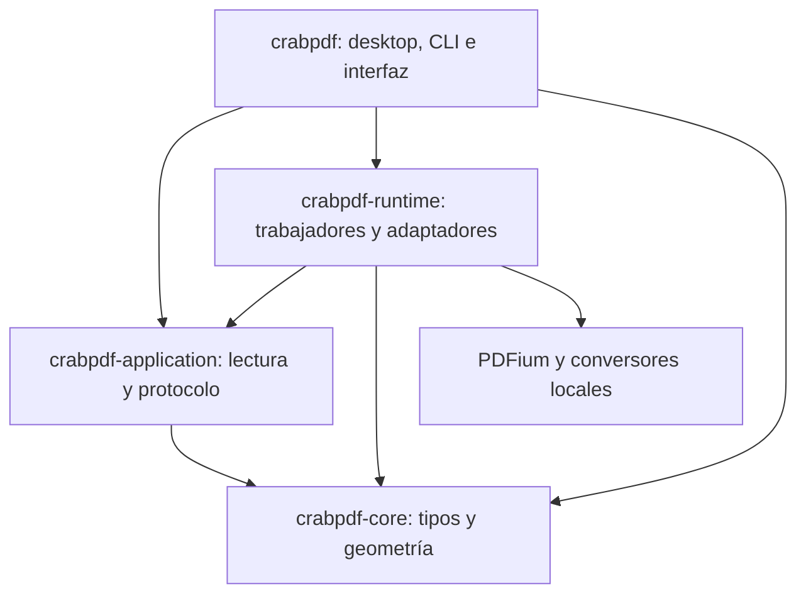

# Arquitectura de CrabPDF

CrabPDF usa un monolito modular en un workspace de cuatro paquetes Rust. La versión pública 0.4.1 incorpora esta organización. Los cambios posteriores de mantenimiento se registran en la [revisión del repositorio](REPOSITORY_REVIEW.md). La decisión está en [ADR-0001](adr/0001-modular-architecture.md), el plan original en [ARCHITECTURE_MIGRATION.md](ARCHITECTURE_MIGRATION.md) y la ejecución final en [PHASE_6.md](architecture/PHASE_6.md).

## Organización del repositorio

| Ruta | Responsabilidad |
| --- | --- |
| `crates/core/src/` | Documento, errores, raster compartido, geometría, regiones y posición normalizada. Sólo std y serde. |
| `crates/application/src/` | Pestañas, navegación, búsqueda, selección, favoritos, perfil, reconciliación de ventanas, formatos y protocolo de eventos. Sólo core, std y serde. |
| `crates/runtime/src/worker/` | Fachada de solicitudes, scheduler, coordinador de importación y propietario serial de documentos PDFium. |
| `crates/runtime/src/pdfium/` | Apertura, metadatos, geometría, rasterización, texto, marcas y exportación, en módulos separados. |
| `crates/runtime/src/formats/` | Conversión, archivos comprimidos, cómics, libros, límites, procesos, caché y OCR DjVu. |
| `crates/runtime/src/storage/` | Escritura atómica, marcas, bloqueo/merge de preferencias y escritor asíncrono. |
| `crates/runtime/src/{paths,source,covers,cache}.rs` | Perfil único, identidad persistente de archivos, portadas y caché por bytes. |
| `src/desktop/` | Composición de servicios, diálogos nativos, nuevas ventanas, servicios del sistema y etiquetas/atajos. |
| `src/ui/` | Recursos gráficos, widgets y coordinación de vista, dividida en acciones, eventos, entrada, solicitudes y sesión. |
| `src/{main,cli,branding,lib}.rs` | Entrada, argumentos, identidad y fachada pública. |
| `assets/` | Logo SVG original; build.rs genera PNG, ICO y recursos del instalador. |
| `tests/fixtures/` | Documentos originales de prueba. `examples/` contiene los recorridos Rust ejecutables. |
| `installer/windows/`, `scripts/` | Definición NSIS y herramientas de construcción, validación y distribución por plataforma. |
| `native/`, `artifacts/`, `target/` | Dependencias descargadas, evidencia/paquetes y compilación; ignorados por Git. |

Las dependencias apuntan hacia dentro. Core y application no cargan bibliotecas, abren archivos, crean hilos ni conocen egui/rfd. Runtime no depende de la interfaz. Los tipos de SDK, handles PDFium, texturas y controles de ventana no cruzan hacia los modelos. Las pruebas de [architecture.rs](../tests/architecture.rs) comprueban el grafo de dependencias y añaden una comprobación de rutas de servicios en las fuentes internas; esta última no pretende analizar todo el lenguaje Rust ni todos los alias posibles.

La fachada `crabpdf::{document,application,engine,worker,config,...}` reexporta las implementaciones para conservar consumidores y ejemplos. No contiene otra implementación, escritura doble ni buffers de conversión entre paquetes. Las APIs nuevas deben usar el paquete propietario. La persistencia explícita es `ProfileStore::{load,save,save_merged}`; `Preferences` es ahora un modelo sin I/O.

## Lectura y presentación

`ReadingTab` conserva la identidad de apertura, opciones iniciales, restauración y estado de lectura. `AppState` aplica límites de página/zoom e historial. Búsqueda y selección conservan sus propias identidades y aceptan resultados compatibles con la consulta y el documento. La vista conserva scroll, foco, geometría y texturas; no se serializan coordenadas de egui.

`desktop::bootstrap::DesktopServices` resuelve AppPaths una vez y construye el perfil y el worker. La UI proporciona una notificación de repintado, no un contexto gráfico a runtime. El diálogo nativo se construye en el hilo UI, incluido macOS; entrega rutas y una identidad de documento. Abrir otra ventana conserva el perfil y la posición mediante argumentos separados, sin interpretar el nombre de archivo como shell.

El cambio de marcas incrementa la revisión. Las imágenes anteriores se conservan sólo como instantáneas de presentación acotadas, hasta que llega el raster nuevo compatible con su geometría. No cuentan como render actual ni alimentan al motor. La selección reutiliza geometría por línea y el desplazamiento al mantener flechas se integra por fotograma.

En fullscreen, el visor usa el área cliente y muestra controles flotantes sólo cuando corresponden. Se conservan la restauración normal/maximizada, ambos estilos de barra y las preferencias de ventana. La verificación de geometría nativa se realiza con `Test-WindowGeometry.ps1`; una captura egui por sí sola no mide el cliente del SO.

## Trabajo en segundo plano y recursos

Un hilo es dueño de todos los documentos y handles PDFium. La aplicación intercambia solicitudes/eventos tipados, incluyendo documento, revisión de raster y generación de búsqueda. No se amplía el pool PDFium durante esta migración.

El scheduler conserva el orden FIFO de operaciones de control/escritura y la prioridad de render visible sobre contenido, precarga, portadas y continuación de búsqueda. Los renders visibles y la precarga mantienen sus límites 96/24 y su deduplicación. El canal de eventos tiene capacidad 2 y el de importaciones 16. La búsqueda puede esperar durante navegación sostenida: la extracción conserva esa política; no promete haber corregido su equidad.

El coordinador de importación prepara libros fuera del hilo PDFium. Cerrar un documento cancela su token y la publicación comprueba que la apertura siga pendiente. Al cerrar el worker se cancela, se despierta el scheduler, se desconectan productores/receptores y se reúnen ambos hilos. Se prueba el caso de productores bloqueados por un canal lleno. Una llamada nativa PDFium en curso no es interrumpible; el cierre espera su retorno.

Se conservan los presupuestos: raster CPU 96 MiB x64 / 32 MiB x86, texturas GPU 64 / 32 MiB y texto 16 MiB por caché. El PDF permanece respaldado por archivo; no se rasteriza completo al abrirlo. Las regiones visibles usan tiles de hasta 1024 × 1024, con tamaño lógico separado de densidad física. Los presupuestos no representan el máximo de memoria del proceso ni incluyen conversores.

Desde 0.4.2 la interfaz confirma cada resultado raster recibido mediante `release_render`. El scheduler prioriza esa confirmación sobre nuevos renders y el motor retira su copia CPU; la textura sigue disponible en la caché visual. Esto evita acumular los mismos píxeles en ambas cachés. Los límites CPU permanecen para consumidores que no confirmen resultados. El contenido de texto se comparte entre cachés con `Arc`, no se copia.

## Persistencia e importación

Los modelos de preferencias y su reconciliación viven en application. El adaptador conserva lectura, bloqueo interproceso y reemplazo atómico. Cada ventana mantiene su propio baseline; el escritor agrupa snapshots sin borrar cambios ajenos. `ProfileSession` inicia o reintenta el escritor y expone fallos; no usa un guardado síncrono como alternativa dentro de un frame. Al salir se vacían las solicitudes pendientes.

No cambian las variables de entorno, rutas heredadas, TOML, esquema 2 de marcas, identidad de archivos, firma preparada ni nombres de caché v4. `runtime::source::fingerprint` conserva la canonicalización/tamaño/fecha/hash anterior; no se convierte en un hash de contenido.

Los importadores mantienen límites de tamaño/entradas, validación de rutas, cancelación, timeout y comprobación de integridad. Una caché sólo se publica como utilizable al verificar todas sus partes y el manifiesto. La reparación de un PDF preparado rechazado conserva su identidad y bloqueo, sin borrar el original.

## Rust y componentes nativos

La lógica de lectura, modelos, sincronización, conversión/orquestación, almacenamiento, interfaz y generación de recursos están escritos en Rust. PDFium, MuPDF, libmobi, DjVuLibre y 7-Zip siguen siendo dependencias nativas; la migración no las reemplaza ni cambia sus licencias.

Existe un puente JavaScript pequeño, [import_info.js](../crates/runtime/src/formats/mupdf/import_info.js), ejecutado por `mutool run` para consultar el índice de libros con la misma paginación de MuPDF. Se conserva para no perder destinos de capítulos. [Razonamiento y alcance](../crates/runtime/src/formats/mupdf/README.md). Las definiciones NSIS y scripts PowerShell/Bash/Python son herramientas de plataforma. No se declara una implementación íntegramente Rust del motor ni de la cadena de distribución.

## Validación y evolución

`cargo test -p crabpdf-core -p crabpdf-application --locked` comprueba las bibliotecas internas sin PDFium ni ventana. `cargo clippy --workspace --all-targets --locked -- -D warnings` y las pruebas del workspace incluyen todos los paquetes. Los contratos de formatos, marcas, procesos, perfil y los recorridos gráficos siguen en el paquete desktop.

CI conserva Windows x86/x64, Ubuntu x64 y macOS ARM/Intel. El empaquetado identifica crabpdf por nombre; el inventario de terceros excluye todos los miembros locales mediante workspace_members. La protección de publicación incluye crates y assets y rechaza fuentes diferentes del tag.

Separar paquetes no acredita por sí mismo más velocidad ni paridad V1. Las mediciones y sus límites se registran en PHASE_6. La 1.0 conserva las condiciones de [V1_PLAN.md](V1_PLAN.md); los plugins Rust/Wasm siguen fuera de esta migración.
