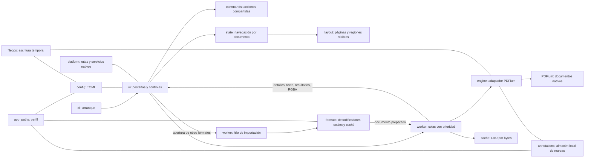

# Arquitectura de CrabPDF

El [plan de migración](ARCHITECTURE_MIGRATION.md) y la [decisión ADR-0001](adr/0001-modular-architecture.md) definen la dirección hacia un monolito modular con puertos y adaptadores. Son diseño pendiente de implementación; esta página conserva la estructura real de 0.3.6.

La lógica de documentos permanece en Rust y fuera de egui. Un único hilo es dueño de PDFium y de todos los documentos nativos. La UI intercambia identificadores, solicitudes y resultados independientes del SDK.

Esta página describe la implementación en desarrollo 0.3.6. La [auditoría](AUDIT_V1.md) documenta la base 0.2; los avances de [0.3.0](IMPLEMENTATION_PROGRESS.md), [0.3.1](IMPLEMENTATION_PROGRESS_0_3_1.md), [0.3.2](IMPLEMENTATION_PROGRESS_0_3_2.md), [0.3.3](IMPLEMENTATION_PROGRESS_0_3_3.md) y [0.3.4](IMPLEMENTATION_PROGRESS_0_3_4.md) distinguen correcciones parciales de las rutas abiertas en [V1_PLAN.md](V1_PLAN.md).

| Componente | Responsabilidad |
| --- | --- |
| `cli.rs`, `main.rs` | Argumentos, ayuda, errores y ventana nativa. |
| `branding.rs`, `build.rs`, `crabpdf-logo.svg` | Identidad CrabPDF, icono de ventana y recursos del ejecutable; rasterización SVG durante la compilación. |
| `commands.rs` | Vocabulario común para menús, contexto, paleta y atajos. |
| `ui/mod.rs` | Pestañas, eventos, diálogos asíncronos y coordinación. |
| `ui/panels.rs` | Menús, barras, miniaturas, índice, favoritos y diálogos. |
| `ui/chrome.rs` | Pestañas integradas, operaciones nativas de ventana y controles flotantes de pantalla completa. |
| `ui/home.rs`, `library.rs` | Biblioteca, tarjetas, portadas diferidas y caché PNG limitada. |
| `ui/viewer.rs` | Viewport, regiones visibles, selección, enlaces y resaltados. |
| `ui/motion.rs` | Desplazamiento programático breve, interrumpible y entradas sin mezclar documentos. |
| `ui/theme.rs`, `ui/icons.rs` | Estilos e iconos vectoriales propios. |
| `state.rs` | Estado de documento, historial, modos, zoom y rotación. |
| `layout.rs` | Geometría, spreads y planificación de tiles. |
| `reading_position.rs` | Ancla versionada relativa a página y viewport, sin tipos de UI/SDK. |
| `document.rs` | Datos y claves sin dependencias de egui/PDFium. |
| `engine.rs` | Carga, contraseña, metadatos, índice, texto, enlaces, búsqueda y rasterización PDF. |
| `worker.rs` | Documentos nativos, cachés, colas y búsquedas progresivas. |
| `formats.rs`, `import_info.js` | Despacho de extensiones, preparación mediante herramientas nativas, límites, caché y metadatos de libros. |
| `djvu_text.rs` | Lectura de la capa OCR existente de DjVu y coordenadas para incorporar texto. |
| `annotations.rs` | Persistencia local de marcas, asociación al archivo y bloqueo entre instancias. |
| `cache.rs` | LRU con presupuesto de bytes. |
| `config.rs`, `fileops.rs` | Preferencias y guardado temporal con reemplazo final. |
| `app_paths.rs` | Perfil compartido por preferencias, documentos preparados, portadas, marcas y ventanas nuevas. |
| `platform.rs` | DLL/dylib/so, configuración, carpetas y nuevas ventanas. |

## Render y memoria

Con un documento en pantalla completa, la UI reserva el lienzo para lectura y muestra los controles flotantes sólo junto al borde superior. El panel lateral usa una visibilidad temporal independiente de las preferencias de ventana. `LayoutSpec::compact` reduce los márgenes y la separación de páginas sin depender de egui; el visor usa barras de desplazamiento flotantes. Los atajos de lectura distinguen foco de texto, diálogos y menús del foco de un botón. La navegación horizontal mide el ancho del pliego actual, conserva el desplazamiento con zoom ampliado y cambia de página cuando el pliego cabe o se alcanza un borde.

El PDF permanece respaldado por un archivo. No se copia todo su contenido a un buffer Rust ni se rasterizan todas las páginas al abrirlo. La primera página proporciona las dimensiones iniciales; las demás se conocen bajo demanda. El modelo estima las páginas desconocidas y corrige la posición al llegar sus dimensiones reales.

Las páginas pequeñas y miniaturas usan una imagen completa acotada. En páginas grandes/con zoom se solicita solamente la cuadrícula visible: regiones de hasta 1024×1024 píxeles. PDFium conserva la escala de toda la página y recorta al pequeño bitmap de destino mediante el origen de render. Una prueba compara las regiones con el raster completo en cuatro rotaciones y tres modos de color.

La geometría de pantalla y los píxeles físicos se separan: 100 % equivale a 96 píxeles lógicos por pulgada; el PDF usa 72 puntos. La densidad incrementa los píxeles, sin cambiar el tamaño lógico. Se rechazan dimensiones patológicas superiores a un millón de unidades lógicas.

| Caché | x64 | x86 |
| --- | --- | --- |
| Raster del worker | 96 MiB | 32 MiB |
| Texturas de UI | 64 MiB | 32 MiB |
| Texto/enlaces, por caché | 16 MiB | 16 MiB |
| Overview, máximo aproximado | 16 MP | 4 MP |
| Región, máximo | 4 MiB RGBA | 4 MiB RGBA |

Estos son presupuestos de caché, **no** un límite de memoria del proceso: conversiones, bitmaps temporales, fuentes y PDFium consumen memoria adicional. Un resultado excesivo no se retiene. Falta validar documentos extremos y medir contra SumatraPDF.

Las operaciones de control tienen prioridad; los rasters visibles preceden a extracción de texto y búsqueda. Una búsqueda trabaja por página y cede a la lectura entre páginas. La UI solicita repaint al recibir un evento; no mantiene un temporizador de render en reposo. El canal contiene como máximo dos resultados y la cola de render tiene un límite.

La UI elimina renders que dejaron de ser visibles. Una llamada nativa ya iniciada termina normalmente; la cancelación no interrumpe PDFium a mitad de una operación. Las claves incluyen documento, revisión del contenido, página, zoom, viewport, densidad, rotación, colores y región. Una marca nueva o un refresco externo cambia esa revisión e invalida rasters CPU/GPU del documento. Resultados de revisiones anteriores y pestañas cerradas se descartan.

## Texto y búsquedas

PDFium proporciona una transformación afín de coordenadas. Incluye CropBox, origen distinto de cero y rotación intrínseca del archivo, antes de aplicar el giro del usuario. Se evita convertir cada esquina mediante FFI para cada carácter.

La selección de ratón y doble clic funciona en una página. Los enlaces y resultados se expresan en coordenadas normalizadas. Al elegir una coincidencia se centra su región en pantalla. La búsqueda distingue generaciones, para que una respuesta tardía no contamine una consulta nueva. Se retienen como máximo 10 000 coincidencias y se indica el límite en pantalla.

Si las dimensiones de la página de destino todavía son desconocidas, la región de búsqueda queda pendiente hasta recibir la geometría real. Centrarla usando la altura estimada podía dejar una coincidencia de una página muy larga fuera de pantalla; `search_smoke` comprueba ese caso con PDFium y una ventana nativa.

Quedan pendientes selección entre páginas/por teclado, búsqueda avanzada y paridad de todos los gestos. Las restricciones de copia se consultan en PDFium.

## Persistencia y errores

Cada pestaña conserva sus propios modos, búsqueda, selección y scroll en memoria. Se guardan recientes, sesiones y favoritos; restaurar sesión es opcional. El TOML guarda página/modo/zoom/giro/colores/manga y un ancla versionada: punto relativo a la página y posición relativa en el viewport, codificados en enteros normalizados. Se captura junto al centro visible (o en el borde de la página si el centro cae en un hueco). La restauración espera la geometría real de la página y se cancela ante navegación explícita, zoom, interacción con el documento o parámetros de vista CLI. Los cambios de scroll programan el guardado diferido, sin escribir desde el frame. Los perfiles anteriores usan la página como alternativa; esquemas de ancla desconocidos o coordenadas fuera de rango tampoco se aplican. No se persiste aún el historial completo ni se valida el ancla contra cambios de contenido del archivo. El planificador mantiene una sola búsqueda activa, aunque cada pestaña tenga su estado visual. Nunca se guarda una contraseña. Su petición se elimina del worker al completar la carga, sin garantía de borrado criptográfico de memoria.

Preferencias y copias PDF se escriben en un temporal en el mismo directorio, se sincronizan y se renombran al destino. El documento de origen abierto se rechaza como destino de copia. Un fallo de escritura conserva el destino anterior. Las preferencias se fusionan bajo un bloqueo entre procesos y un hilo de disco evita esperar la escritura en la UI; faltan casos de sesiones concurrentes sobre el mismo archivo, errores de disco y cierre abrupto. Los errores de biblioteca, archivo, seguridad, render o configuración se muestran explícitamente.

PDFium sigue siendo el motor de páginas. `formats.rs` prepara los formatos básicos mediante decodificadores locales y una caché de PDF interno; las aperturas explícitas y las portadas sin caché se preparan en el hilo de importación antes de llegar a PDFium. La caché v4 verifica tamaño y CRC de PDF y sidecars mediante un manifiesto publicado al final bajo bloqueo por entrada. La espera de ese bloqueo es cancelable y tiene un máximo de 15 segundos. Los registros de listado y metadatos se acotan antes de cargarlos. Si PDFium rechaza un PDF preparado de una apertura, el worker pide al importador que descarte esa entrada y la reconstruya una sola vez; el render no ejecuta el decodificador. Todavía faltan el caso equivalente de portadas, competencia con la poda, fallos de borrado con otro lector abierto y medidas del coste de verificar entradas grandes. `djvu_text.rs` conserva texto OCR disponible en DjVu y lo incorpora de forma diferida por página. Los cómics se extraen con rutas y tamaños validados y se ordenan numéricamente. `import_info.js` recupera título/índice de los libros mediante el programa propio de MuPDF, sin ejecutar scripts del documento.

`annotations.rs` conserva marcas locales asociadas al archivo y a una firma del PDF preparado. El esquema 2 detecta si un importador produjo otra paginación: conserva las marcas antiguas, pero las deja sin aplicar y presenta un aviso para evitar marcarlas en el texto equivocado. Los PDF antiguos mantienen sus marcas compatibles. El worker crea anotaciones PDF nativas con quad points en orden Z; antes de exportar refresca las marcas bajo el bloqueo del almacén, y las revisiones invalidan las páginas afectadas y los resultados pendientes. El original no se sobrescribe. Faltan anclas por cita/contexto, migración segura y una prueba entre dos procesos de exportación. Estos límites se relacionan con F02/F03/F06 de la auditoría histórica.

La selección sigue limitada a una página. Impresión, edición general, formularios y los restantes formatos/servicios de referencia requieren componentes adicionales. [Formatos, almacenamiento y límites](FORMATS_AND_ANNOTATIONS.md).

## Transiciones y viewport en 0.3.5

`ui/motion.rs` anima únicamente el desplazamiento y la entrada del contenido actual. El lienzo permanece opaco; no hay una textura duplicada ni mezcla de dos documentos. Los saltos cercanos se limitan a 160 ms, con cancelación por interacción y ajuste de ambos extremos cuando llega geometría real. Se elimina el objetivo cinético anterior de egui al aplicar un salto programático.

El visor mantiene barras flotantes sin degradado y sin reserva variable de ancho. La vista previa debe coincidir en documento, revisión, página, giro y colores. La navegación a un destino frío espera como máximo 200 ms y la precarga vecina sigue dentro de los presupuestos existentes. Los avisos de éxito flotan sin alterar el viewport. `reduce_motion` es una preferencia TOML con valor por defecto compatible. [Regresiones y límites](IMPLEMENTATION_PROGRESS_0_3_5.md).

## Ventana y documento en 0.3.6

`ReaderApp::sync_fullscreen` centraliza F11, Escape, presentación y arranque CLI. En Windows retira temporalmente el estado maximizado antes de entrar, para evitar que `WM_NCCALCSIZE` limite el cliente al área de trabajo del monitor. Reaplica decoraciones tras el cambio para actualizar la sombra del marco sin decorar y restaura el estado maximizado al salir. No introduce FFI en el lector.

`Preferences::favorites_for` filtra por ruta de origen y ordena por página; quitar una entrada usa ruta y página. El almacén TOML conserva su formato y los favoritos de otros libros. El panel navega directamente en la pestaña activa. `ui/chrome.rs` sigue el ID estable de la pestaña durante el arrastre y reutiliza la acción de duplicado al soltar fuera; el estado guardado proporciona el ancla de lectura.
