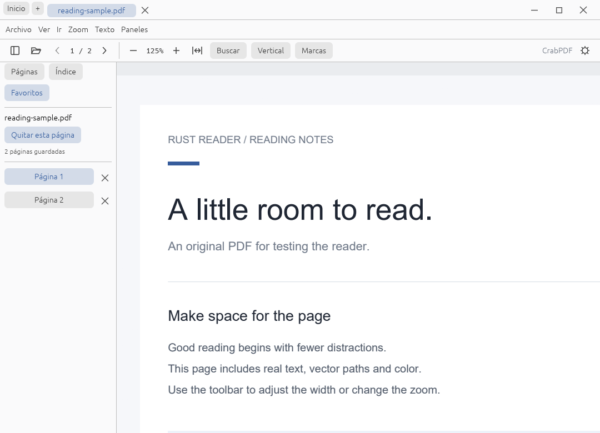

# Guía de uso

Versión pública: **0.4.1**, de desarrollo. [Descargas](https://github.com/MHAlberto/crabpdf/releases/tag/v0.4.1) · [Índice](README.md)

## Abrir y leer

Abre archivos con el botón de carpeta, Ctrl+O o arrastrándolos a la ventana. Cada documento tiene su pestaña. Arrastrar una pestaña fuera de la barra abre otra ventana con su página, zoom y punto de lectura; Escape cancela el gesto.

Los documentos nuevos empiezan en lectura continua ajustada al ancho. **Vertical** aplica ese modo a un documento que ya estaba abierto. Los modos guardados de otros documentos se conservan.

**Inicio** vuelve a la biblioteca sin cerrar las pestañas. El contexto de una portada permite quitarla del historial; no borra el archivo original. Los favoritos del panel corresponden al documento activo.



## Seleccionar y marcar

1. Haz doble clic sobre una palabra o arrastra para seleccionar una frase de la página.
2. Abre **Marcas** y elige resaltar, subrayar y color.
3. Usa Ctrl+Z para deshacer la última marca.
4. Usa **Guardar una copia** para exportar un PDF con las anotaciones.

Las marcas se conservan localmente y no modifican el archivo original al aplicarlas. La selección actual no atraviesa páginas. Los permisos del PDF pueden limitar la copia de texto. Si una conversión antigua carece de una firma de paginación compatible, se conservan las marcas y se muestra un aviso para evitar aplicarlas a otro texto.

[Formatos y anotaciones](FORMATS_AND_ANNOTATIONS.md).

## Atajos

| Acción | Windows / Linux |
| --- | --- |
| Abrir / cerrar documento / guardar copia | Ctrl+O / Ctrl+W / Ctrl+S |
| Biblioteca | Ctrl+Mayús+H |
| Buscar / siguiente / anterior | Ctrl+F / F3 / Mayús+F3 |
| Desplazamiento vertical | Arriba/Abajo o K/J |
| Página anterior/siguiente; desplazamiento con zoom ampliado | Izquierda/Derecha o H/L |
| Página anterior / siguiente | P / N |
| Desplazar una pantalla | Re Pág / Av Pág / Espacio |
| Primera / última página | Inicio / Fin |
| Ir a página / paleta de comandos | Ctrl+G / Ctrl+K |
| Zoom / ajustar página / tamaño real / ancho | Ctrl y +/− / Ctrl+0 / Ctrl+1 / Ctrl+2 |
| Una página / enfrentadas / libro | Ctrl+6 / Ctrl+7 / Ctrl+8 |
| Siguiente pestaña / reabrir cerrada | Ctrl+Tab / Ctrl+Mayús+T |
| Pantalla completa / presentación | F11 / F5 |
| Invertir / restaurar colores | F6, también Mayús+I |
| Barra / menú / panel lateral | F8 / F9 / F12 |
| Resaltar / subrayar selección | Ctrl+Mayús+L / Ctrl+Mayús+U |
| Deshacer última marca | Ctrl+Z |

En macOS se usa ⌘ para acciones de aplicación. ⌘+G busca el siguiente resultado, ⌘+Alt+G va a una página y ⌘+0 muestra tamaño real. La matriz gráfica macOS todavía necesita validación.

F11 oculta las barras. Acerca el puntero al borde superior para mostrar los controles flotantes; F12 abre temporalmente el panel lateral. Escape o F11 salen de pantalla completa. Las flechas conservan su función de edición cuando hay un campo de texto, menú o diálogo activo.

La inversión con F6 afecta a la lectura y no cambia el PDF guardado. **Reducir movimiento**, en Preferencias, desactiva las transiciones de la interfaz.

## Línea de comandos

```sh
crabpdf --page 2 --zoom fit-page --view facing documento.pdf otro.pdf
crabpdf --search reader --rotate 90 --continuous documento.pdf
crabpdf --colors inverted documento.pdf
crabpdf --config perfil.toml documento.pdf
crabpdf --help
```

También se aceptan `-page`, `-zoom`, `-view`, `-search`, `-fullscreen` y `-presentation`. Los parámetros todavía no implementados producen un error explícito. En Windows release, la ayuda y los errores CLI aparecen en un diálogo porque el ejecutable no abre una consola.

Los parámetros de vista explícitos prevalecen sobre la posición guardada. La lista completa está en `--help` y en [src/cli.rs](../src/cli.rs).

## Preferencias y datos

| Sistema | Archivo de preferencias predeterminado |
| --- | --- |
| Windows | `%APPDATA%/rust-reader/preferences.toml` |
| macOS | `~/Library/Application Support/rust-reader/preferences.toml` |
| Linux | `$XDG_CONFIG_HOME/rust-reader/preferences.toml` o `~/.config/rust-reader/preferences.toml` |

El nombre heredado `rust-reader` y las variables `RUST_READER_*` se conservan por compatibilidad. No cambies esas rutas para adoptar el nombre nuevo sin migrar primero los datos.

- `--config` o `RUST_READER_CONFIG` eligen otro archivo de preferencias.
- `CRABPDF_DATA_DIR` permite separar la raíz de datos derivados.
- `RUST_READER_PDFIUM` indica una biblioteca PDFium concreta.
- `CRABPDF_FORMAT_TOOLS` indica dónde están los conversores.

Las preferencias contienen rutas del historial, favoritos y sesiones. La restauración de sesión se habilita en Preferencias. Las contraseñas no se persisten.

Las portadas se guardan en `covers/`, junto al perfil. Su clave incorpora ruta, tamaño y fecha del archivo; la caché conserva hasta 64 PNG y las texturas tienen un límite de 8 MiB. El guardado de posición agrupa cambios durante 500 ms. Un cambio del archivo o su paginación puede invalidar la posición guardada.

Las escrituras de preferencias ocurren fuera de la UI, combinan cambios de varias ventanas bajo bloqueo y usan reemplazo atómico. Esto no equivale a un historial completo de navegación persistente ni a tener resueltos todos los conflictos de sesiones concurrentes.

## Compatibilidad comprobada

| Entorno | Evidencia disponible | Pendiente |
| --- | --- | --- |
| Windows 10 x64 | Interfaz, motor, instalación y lectura local | Más equipos, GPU y escalas |
| Windows x86 | Proceso bajo WOW64 y CI | SO Windows de 32 bits nativo |
| Windows 11 | Objetivo de compatibilidad | Prueba física específica |
| Ubuntu 24.04 x64 | DEB instalado, hashes y ventana del lector bajo Xvfb/Mesa | Escritorio físico y Wayland |
| Otras distribuciones Linux | TAR para glibc 2.36 o posterior | Validación propia por distribución |
| macOS Intel / ARM | CI de compilación y pruebas PDF | Interfaz física, otros formatos e instalador |

[Validación de la entrega](releases/v0.4.1-publication.json). Las funciones pendientes de 1.0 están en [ROADMAP.md](ROADMAP.md).
