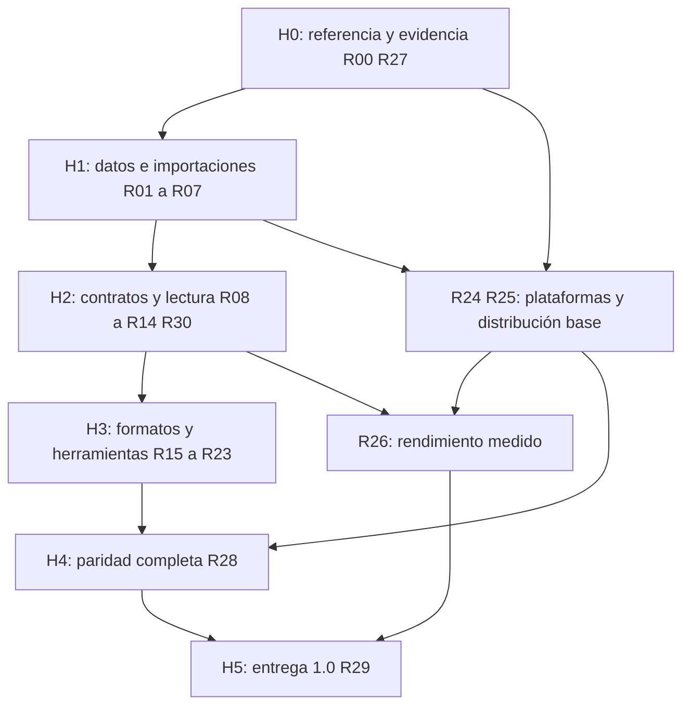

# Rutas de implementación hasta CrabPDF 1.0

Base: **0.2.0**, 13 de octubre de 2026. Este documento convierte la [auditoría](AUDIT_V1.md) en trabajo ejecutable. Los IDs R00–R30 corresponden a [V1_BACKLOG.csv](V1_BACKLOG.csv). Todas las rutas siguen pendientes como entregas completas, aunque aprovechen funciones existentes. No se cambió la versión de la aplicación.

La implementación posterior de **0.3.0** avanzó parcialmente R01–R08; [IMPLEMENTATION_PROGRESS.md](IMPLEMENTATION_PROGRESS.md) registra código, pruebas y límites sin alterar los criterios de salida de este plan.

La revisión **0.3.1** añade un reintento acotado de PDFs internos rechazados por PDFium. [Resultados y límites](IMPLEMENTATION_PROGRESS_0_3_1.md).

La revisión **0.3.2** acota y hace cancelable la espera del bloqueo de caché, además de limitar lecturas de registros de importación antes de cargarlos. [Resultados y límites](IMPLEMENTATION_PROGRESS_0_3_2.md).

La revisión **0.3.3** corrige pantalla completa, márgenes, salida desde presentación y navegación por flechas según zoom/foco. Avanza parcialmente R13 y R22; sus criterios completos siguen abiertos. [Resultados y límites](IMPLEMENTATION_PROGRESS_0_3_3.md).

La revisión **0.3.4** avanza R10: guarda el punto relativo a la página y manga, restaura con otro tamaño/escala y respeta la vista explícita CLI. El historial completo y la reconciliación de sesiones concurrentes de R03 siguen pendientes. [Resultados y límites](IMPLEMENTATION_PROGRESS_0_3_4.md).

La revisión **0.3.5** avanza parcialmente R13, R16 y R22: navegación sin objetivo de scroll residual, transiciones breves, viewport sin pie inferior, Marcas compacto y controles de cierre vectoriales. No completa el editor ni la paridad visual. [Resultados y límites](IMPLEMENTATION_PROGRESS_0_3_5.md).

En el CSV, **P0** es trabajo previo para proteger datos y establecer evidencia; **P1** es el resto de trabajo necesario para la 1.0. La prioridad ordena la ejecución y no elimina requisitos.

## Qué significa terminar 1.0

1. Inventario completo de comportamientos visibles de la revisión fijada: menús, contexto, preferencias, atajos, gestos, formatos, diálogos, persistencia, errores e integraciones. Cada caso tiene fuente, implementación y evidencia. Un comando puede necesitar muchos casos.
2. Paridad verificada caso por caso y por plataforma aplicable, incluyendo funciones recientes de la referencia. Una diferencia exige un equivalente comprobado; no se oculta como «no aplica» sin justificación. Las exclusiones que reduzcan el alcance acordado necesitan una decisión explícita del usuario.
3. Lectura continua fluida, documentos/selecciones/anotaciones consistentes, exportación e impresión correctas, recuperación de errores y migración sin pérdida silenciosa.
4. Ejecución real y paquetes instalables/portables adecuados en toda la matriz objetivo. X86 bajo WOW64 y CI preparada no sustituyen los entornos faltantes.
5. Presupuestos de rendimiento/tamaño fijados con mediciones y cumplidos; informes reproducibles frente a SumatraPDF, sin prometer ventaja por usar Rust.
6. Pruebas funcionales, accesibilidad, robustez, revisión de dependencias y contenido distribuido. Ningún defecto abierto que pueda perder datos o impedir una ruta básica de lectura.

Hasta cumplir estas condiciones, conservar una versión de desarrollo. No es posible dar una fecha responsable sin expandir el inventario y medir las rutas más costosas. Los hitos siguientes son puertas de aceptación, no semanas de calendario.

## Principios de ejecución

- Mantener egui/eframe, PDFium y la implementación independiente en Rust. Extraer responsabilidades dentro de un cambio concreto; evitar una migración global.
- Resolver primero sincronización y contratos de datos. No ampliar un modelo de marcas incompatible para luego cambiar todos sus consumidores.
- Portar y medir desde temprano. Las rutas de plataformas y rendimiento pueden comenzar con la base actual; sus dependencias en CSV son condiciones para **cerrarlas**, no una prohibición de investigarlas antes.
- Una entrega pequeña incluye código, regresión pertinente, documentación y evidencia; no un control vacío. Las funciones de herramientas externas se cargan bajo demanda y se activan explícitamente.
- El usuario autorizó publicaciones en https://github.com/MHAlberto/crabpdf. Continuar pruebas locales y comprobar cada ejecución remota; un workflow escrito no acredita sus resultados.

## Hitos y dependencias



| Hito | Resultado entregable | Puerta de salida |
| --- | --- | --- |
| H0 — Inventario y línea base | Casos observables por familia, corpus con procedencia, informe de entornos y medición inicial. | Ninguna familia del menú/despacho queda sin registrar; pendientes de investigación visibles; prueba nativa nunca pasa por omisión silenciosa. |
| H1 — Núcleo consistente | Exportación/sincronización correctas, perfiles aislados, importación/caché recuperables y cancelables, anclas versionadas. | Regresiones F01–F09 correctas en x64/x86 y contratos independientes de Windows. |
| H2 — Lectura y aplicación completas | Selección, búsqueda, zoom, navegación, paneles, sesión, accesibilidad y controles coherentes. | Casos de lectura/ventanas aprobados; UI no depende de etiquetas traducidas; errores finalizan todas las solicitudes. |
| H3 — Paridad funcional amplia | Formatos fieles, editor de anotaciones/PDF, formularios, firmas, impresión e integraciones. | Familias funcionales completas; operaciones destructivas explícitas y comprobadas con recuperación. |
| H4 — Verificación de referencia | Comparación control por control y diferencias por sistema resueltas. | Inventario sin funciones obligatorias pendientes/parciales; evidencia enlazada a builds y corpus. |
| H5 — Candidato y entrega | Paquetes completos, migraciones, avisos/fuentes, instalación/desinstalación y rendimiento aprobados. | Matriz íntegra ejecutada; errores críticos cerrados; informes y artefactos identificados por hashes. |

## Primera entrega recomendada

1. **R01 + R02:** escribir regresiones de A/B exportando marcas y refresco multipágina; después corregir instantánea, revisión e invalidación. Evitar cambiar a la vez el editor visual.
2. **R03:** propagar `AppPaths` y cerrar reconciliación de preferencias entre procesos; comprobar perfiles CLI, nuevas ventanas y conservación de favoritos.
3. **R04:** sacar conversión de portadas del worker PDF y finalizar aperturas rechazadas por cola llena. Probar con importador detenido mediante un mecanismo de sincronización de prueba.
4. **R05 + R06:** caché transaccional, plazo/cancelación de importación y guard de proceso. Inyectar fallos entre etapas; conservar los originales y el último resultado confirmado.
5. **R07:** esquema/anclas versionadas antes de reflujo o actualización de decodificadores. Probar migración y marcas no resolubles.

Mientras se ejecuta esa secuencia, R00 completa los casos y R27 prepara corpus/harness. La salida es una base 0.x más fiable; no implica alcanzar 1.0.

## Rutas de código y pruebas

Las rutas bajo **actual** existen. Las rutas bajo **propuesta** son archivos/módulos que aún no se han creado; son destinos razonables, ajustables al implementar. No crear directorios vacíos ni todos los módulos por adelantado. Si se convierte `foo.rs` en `foo/mod.rs`, hacerlo en el cambio correspondiente y actualizar imports y esta tabla.

| ID | Entrega y rutas actuales | Rutas propuestas y aceptación principal |
| --- | --- | --- |
| R00 | Referencia: `docs/parity/{reference.json,commands.csv,cases.md}`, `docs/actions.csv`. | `docs/parity/behaviors.csv`, `docs/parity/platform-cases.md`: ID estable, fuente/condición/acción/resultado/foco/atajo/errores/plataforma/evidencia. Cubrir aliases, argumentos, submenús y comportamientos sin comando. |
| R01 | Exportación coherente: `src/engine.rs`, `src/annotations.rs`, `tests/formats_and_marks.rs`. | `tests/annotation_sync.rs`: A marca, B exporta y un lector nativo reabierto confirma el contenido. No dañar destino ante fallo. |
| R02 | Revisión e invalidación: `src/document.rs`, `src/worker.rs`, `src/ui/mod.rs`. | `tests/document_revision.rs`: múltiples páginas/instancias/duplicados, deshacer y respuesta tardía; ninguna textura queda con contenido previo. |
| R03 | Perfil y preferencias: `src/platform.rs`, `src/config.rs`, `src/ui/mod.rs`. | `src/app_paths.rs`, `src/session_store.rs`, `tests/profile_sessions.rs`: `--config` coherente, dos procesos no pierden favoritos, escritura no bloquea UI, esquemas compatibles. |
| R04 | Portadas y aperturas: `src/library.rs`, `src/worker.rs`, `src/ui/mod.rs`. | `src/import_jobs.rs`, `tests/import_scheduling.rs`: render avanza con portada en conversión; cola llena/cierre/reintento llegan a estado terminal. |
| R05 | Caché preparada: `src/formats.rs`, `src/fileops.rs`. | `src/import_cache.rs`, `tests/import_cache.rs`: publicación de PDF/sidecars como una entrada, bloqueo/revalidación, reparación acotada y poda que respeta entradas activas. |
| R06 | Ciclo de trabajo: `src/formats.rs`, `src/worker.rs`, `src/annotations.rs`. | `src/process_job.rs`, `tests/job_lifecycle.rs`: cancelar/cerrar/error mata y espera hijos; plazo total y lectura/tamaño acotados; ningún temporal queda publicándose. |
| R07 | Esquema de marcas: `src/annotations.rs`, `src/document.rs`, `src/engine.rs`. | `src/annotation_anchor.rs`, `tests/annotation_migration.rs`: versión del documento preparado, migración con respaldo, contextos de texto y marcas ambiguas conservadas. |
| R08 | Contratos tipados: `src/document.rs`, `src/engine.rs`, `src/worker.rs`, `src/ui/mod.rs`. | `src/document_capabilities.rs` si el tamaño lo justifica; pruebas de capacidades/progreso/errores: UI deja de interpretar «Marcas locales»/«Título» como protocolo. |
| R09 | Coordinación incremental: `src/ui/mod.rs`, `src/ui/panels.rs`, `src/commands.rs`, `src/formats.rs`. | `src/ui/{tab,input,dialogs,controller}.rs`; subdividir proveedores de formatos cuando se modifiquen. Mismos flujos visibles y suite actual correcta tras cada extracción. |
| R10 | Punto de lectura: `src/state.rs`, `src/layout.rs`, `src/reading_position.rs`, `src/config.rs`, `src/ui/mod.rs`. | 0.3.4 implementa ancla normalizada y manga; `tests/reading_session.rs` y `examples/reading_session_smoke.rs` comprueban página larga con tamaño/escala distintos y prioridad CLI. Falta historial completo y equivalentes por plataforma. |
| R11 | Planificación/escala: `src/worker.rs`, `src/layout.rs`, `src/ui/viewer.rs`. | `tests/search_scheduling.rs`, `tests/large_layout.rs`: dos búsquedas con progreso definido, cancelación por generación, precisión y coste medidos en libros extensos. |
| R12 | Texto/enlaces: `src/engine.rs`, `src/document.rs`, `src/ui/viewer.rs`. | `src/selection.rs`, `tests/text_navigation.rs`: selección entre páginas/teclado, clusters/RTL, copiar texto/imagen/enlace y navegación accesible. |
| R13 | Lectura/paneles: `src/layout.rs`, `src/state.rs`, `src/commands.rs`, `src/ui/{viewer,panels}.rs`. | `tests/view_behaviors.rs`, ampliar `examples/refinement_smoke.rs`: zoom fraccional/contenido/selección, scroll automático, guías, TOC jerárquico, favoritos y presentación según inventario. |
| R14 | Accesibilidad/idiomas: `Cargo.toml`, `src/ui/`, `src/commands.rs`. | `src/ui/accessibility.rs`, `src/i18n.rs`, `locales/`, `docs/testing/accessibility.md`: árbol semántico/foco comprobados con NVDA/VoiceOver/Orca y mensajes sin dependencia lógica del idioma. |
| R15 | Formatos fieles: `src/formats.rs`, `src/djvu_text.rs`, `src/import_info.js`, herramientas nativas. | `src/formats/{detect,ebook,comic,chm,image}.rs` solo al subdividir; `tests/format_corpus.rs`: sniffing, variantes, enlaces/índices, reflujo y formatos restantes del despacho; mismas capacidades/diagnósticos en cada SO. |
| R16 | Editor de anotaciones: `src/annotations.rs`, `src/engine.rs`, `src/ui/viewer.rs`. | `src/annotation_edit.rs`, `src/ui/annotations.rs`, `tests/annotation_editor.rs`: CRUD de existentes/nuevas, propiedades, selección, tipos completos, undo/redo, permisos y exportación interoperable. |
| R17 | Operaciones PDF: `src/engine.rs`, `src/fileops.rs`, `src/commands.rs`. | `src/pdf_operations.rs`, `tests/pdf_operations.rs`: páginas/texto/imágenes, combinar/cifrar/extraer/aplanar y redacción real; verificar contenido extraído y recuperación ante fallo. |
| R18 | Formularios: `src/engine.rs`, `src/document.rs`, `src/ui/viewer.rs`. | `src/forms.rs`, `tests/forms.rs`: campos, teclado, apariencia/valor, guardado/reapertura y permisos; inventariar explícitamente los tipos admitidos por referencia. |
| R19 | Firmas: futura ruta de edición y capacidades nativas. | `src/signatures.rs`, `tests/signatures.rs`: firma visual separada de firma/certificación criptográfica, estados/errores claros y verificación externa; editar no presenta como válida una firma invalidada. |
| R20 | Impresión: `src/platform.rs`, `src/commands.rs`, `src/cli.rs`, capacidades de documento. | `src/printing/{mod,windows,macos,linux}.rs`, `tests/print_plan.rs`, `docs/testing/printing.md`: rangos/escala/selección/duplex según referencia, cancelación, cola/impresora real y modo CLI. |
| R21 | CLI/integración: `src/cli.rs`, `src/main.rs`, `src/platform.rs`. | `src/synctex.rs`, `src/platform_integration.rs`, `tests/cli_compat.rs`: opciones/códigos de salida, instancia existente, SyncTeX y asociaciones/preview/búsqueda con equivalentes por SO. |
| R22 | Acciones/preferencias avanzadas: `src/commands.rs`, `src/config.rs`, `src/ui/{mod,panels}.rs`. | `src/action_spec.rs`, `tests/action_contracts.rs`: catálogo único, argumentos y atajos configurables, estados/foco, colores, ayuda y migración TOML. |
| R23 | Funciones recientes: catálogo fijado y servicios de plataforma. | `src/read_aloud.rs`, `src/external_actions.rs`, `src/pdf_scripts.rs`: voz, traducción/búsqueda/IA externas, comandos/scripts con activación y acceso explícitos, errores recuperables; lectura local independiente. |
| R24 | Motores en otros SO: `scripts/Get-Pdfium.ps1`, `scripts/Get-FormatTools.ps1`, CI y descubrimiento nativo. | `scripts/Test-Platform.ps1`, recetas nativas por SO, `docs/testing/platforms.md`: preparar PDFium/decodificadores para ABI exacta y ejecutar formatos/marcas/UI en Linux y macOS, sin depender del PATH del desarrollador. |
| R25 | Portable/Windows: `scripts/{Pack-Portable,Verify-Portable}.ps1`, `src/platform.rs`, `src/formats.rs`. | `packaging/windows/`, `tests/tool_discovery.rs`: staging nuevo, inventario exacto, carga determinista, instalador/desinstalador, x64/x86 en equipos limpios y prueba de actualización. |
| R26 | Rendimiento/tamaño: cachés, worker, layout, ejemplos. | `scripts/Measure-Reader.ps1`, `docs/benchmarks/`, manifiestos de corpus: comparar builds identificadas, fijar presupuestos y cumplirlos sin pérdida de fidelidad. |
| R27 | Corpus/robustez/toolchain: `tests/`, `scripts/Test-Local.ps1`, `Cargo.toml`, CI. | `tests/corpus/manifest.json`, `docs/testing/robustness.md`, `fuzz/` para parsers propios si procede: casos corruptos/límites/concurrencia, MSRV coherente, fallos explícitos por motor ausente y avisos nativos revisados. |
| R28 | Cierre funcional: inventario y recorridos gráficos/manuales. | `docs/parity/evidence/`, `docs/parity/release-matrix.csv`: cada comportamiento obligatorio verificado en plataforma pertinente con comandos/hashes; diferencias justificadas y aceptadas cuando cambien alcance. |
| R29 | Candidato y entrega: scripts, avisos, dependencias y evidencia. | `packaging/{linux,macos}/`, `docs/RELEASING.md`: paquetes completos, firma/notarización según canal, migración/instalación/desinstalación, licencias/fuentes/SBOM, presupuesto y matriz aprobados antes de 1.0. |
| R30 | Flujo de archivos/ventanas: `src/ui/{mod,chrome,home}.rs`, `src/config.rs`, `src/platform.rs`. | `tests/window_file_flows.rs`: grupos/MRU/colores, renombrar/eliminar, carpeta/adjuntos, historial/sesiones/archivos movidos; operaciones explícitas y coherencia con múltiples ventanas. |

R17–R19 no implican que PDFium ya proporcione todas las capacidades requeridas: verificar API, fidelidad y restricciones de la versión fijada antes de elegir implementación. Reutilizar herramientas nativas existentes puede ser apropiado; documentar coste, permisos y distribución. No añadir un motor completo sin esa evaluación.

## Matriz de plataformas y paquetes

Las versiones de distribución listadas como objetivo deben fijarse en R00/R24 junto con fecha de soporte, glibc/SDK mínimo y fuentes. No se declara soporte por inferirlo del nombre del target Rust.

| Objetivo | Target/ejecución | Evidencia hoy | Cierre pendiente |
| --- | --- | --- | --- |
| Windows 10 x64 | `x86_64-pc-windows-msvc`, SO build 19045 probado. | Compilación, pruebas nativas y recorridos gráficos. | Servicios nativos, impresión, accesibilidad, corpus y paquete final; documentar mínimo técnico concreto. |
| Windows 10 x86 | `i686-pc-windows-msvc` en SO de 32 bits. | Solo proceso WOW64 en Windows 10 x64. | VM/equipo x86 real, presión de memoria/direcciones y todas las herramientas. |
| Windows 11 x64 + app x86 | Ambos targets Windows; x86 bajo WOW64. | Ninguna ejecución Windows 11 documentada. | Probar ambos binarios y servicios del sistema. No prometer un Windows 11 de 32 bits. |
| Ubuntu/Debian/Linux Mint x64 | `x86_64-unknown-linux-gnu`. | Desde 0.3.3: binario glibc 2.36 y paquetes tar/DEB; Ubuntu 24.04 en Docker con Xvfb. Debian/Mint sin ejecutar. | Elegir versiones objetivo/LTS y ABI; GNOME/Cinnamon, X11/Wayland donde existan, portales, fuentes, impresión y paquetes. |
| Fedora/openSUSE/Arch x64 | Mismo target; bibliotecas y escritorios propios. | Sin validación. | Versiones/snapshot fechados, GNOME/KDE, X11/Wayland, Mesa y restricciones de empaquetado. No inferir soporte de Ubuntu. |
| macOS Intel | `x86_64-apple-darwin`. | CI de 0.3.4 (`a6cdd22`): build y siete pruebas nativas PDF; sin interfaz ni otros formatos. | Versión mínima/SDK, `.app`, Retina/monitores, permisos, impresión, VoiceOver y herramientas x64. |
| macOS Apple Silicon | `aarch64-apple-darwin`. | CI de 0.3.4 (`a6cdd22`): build y siete pruebas nativas PDF; sin interfaz ni otros formatos. | Herramientas arm64 nativas, mismos casos; no tratar Rosetta como prueba de binario arm64. |

Linux ARM/32 bits no se añaden como requisito: la petición de 32/64 bits se refiere explícitamente a Windows. Si se amplía ese alcance, incorporar targets y evidencia. Windows 10 sigue siendo objetivo técnico del usuario; esto no representa una afirmación sobre soporte comercial del sistema operativo.

## Rendimiento: método y presupuestos

R26 empieza con una medición base antes de optimizar. Registrar CPU/RAM/GPU/disco, SO/driver, build/hash, motor, arquitectura, bytes/páginas y hash de cada fixture. Preparar un corpus redistribuible y otro local opcional; no subir documentos personales.

- Separar arranque vacío, PDF directo, conversión fría y reapertura desde caché. Medir primera página visible y resolución final por separado.
- Usar los mismos archivos, dimensiones de ventana, DPI, modo/zoom y equipo para ambas aplicaciones. Identificar también la build/revisión de SumatraPDF. Si se usa una estable distinta, presentarla como comparación secundaria.
- Repetir por escenario y publicar número de muestras, mediana/p95, errores y condiciones de caché; indicar cómo se consiguió frío real o la limitación.
- Medir latencia de respuesta, CPU en reposo, picos de RSS/commit del **árbol de procesos**, GPU/texturas, tamaño ZIP e instalado completo. Añadir x86 bajo memoria restringida.
- La primera medición fija presupuestos por escenario y límites de regresión. Hasta entonces no inventar metas como «menos de 20 MB» o «cero cargas». La aceptación de scroll continuo incluye precarga útil, estabilidad visual y respuesta bajo presión, no promesa de latencia cero en cualquier documento.

Optimizar solo con evidencia: cola de portadas, cancelación, geometría/indexado, reutilización de buffers, extracción/paginación incremental y bibliotecas duplicadas. Mantener pruebas de fidelidad para que una reducción de memoria no oculte contenido.

## Diseño de evidencia de paridad

Cada caso futuro de `behaviors.csv` debe contener al menos:

```text
case_id, family, upstream_ref, source_path, control_or_command,
preconditions, steps, expected_result, focus_shortcut_persistence,
platform, fixture_id, implementation_paths, test_or_manual_procedure,
status, evidence_path, build_hash, checked_at, remaining_difference
```

Estados: `pendiente`, `parcial`, `implementado_sin_validar`, `paridad_verificada`; los identificadores internos se clasifican separadamente con motivo y uso. Toda evidencia registra resultado real y entorno. Un caso pendiente no se convierte en aprobado porque exista el test escrito; uno omitido por biblioteca ausente tampoco aprueba.

Ejemplos de aceptación que deben convertirse en casos:

- Selección: comenzar en una página y terminar en la siguiente; copiar conserva orden; marcar y exportar conserva ambos rangos; invertir arrastre/rotar no cambia el texto seleccionado.
- Continuo: PDF de tamaños mixtos, varias ruedas rápidas, vuelta atrás y zoom; siguiente página aparece mediante precarga, sin salto al descubrir dimensiones, dentro del presupuesto acordado.
- Importación: abrir cómic grande, cancelar, abrir PDF y cerrar ventana; el PDF responde, no hay proceso huérfano ni caché parcial publicada.
- Impresión: páginas 2–4 de un documento girado con escala elegida; verificar salida/cola y cancelar sin bloquear la UI.
- Accesibilidad: lector de pantalla identifica menú, pestaña, página, selección y error; todo el flujo se opera por teclado sin perder foco.

## Decisiones pendientes y cómo resolverlas

| Decisión | Trabajo previo necesario | Regla provisional |
| --- | --- | --- |
| Motor/layout para reflujo de libros | Corpus, preservación de anclas y evaluación de capacidades nativas. | Mantener preparación actual para lectura fija mientras se desarrolla R15. |
| Edición, firmas y scripts no cubiertos por PDFium | API/prototipo, seguridad, fidelidad, coste y licencias por capacidad. | Capacidades explícitas; no mostrar acción como disponible si falla siempre. |
| Versiones mínimas Linux/macOS y canales de paquete | Builds/ejecución, ABI de motores y sistemas disponibles. | Estado pendiente; no simular resultados de CI. |
| Aislamiento de motores nativos | Modelo de amenazas, corpus malformado y medición de IPC/memoria. | Endurecer límites/cancelación primero; Rust seguro no aísla automáticamente FFI. |
| Presupuestos de rapidez/ligereza | Benchmark comparable del producto completo. | Conservar límites actuales y medir regresiones; no prometer cifras no observadas. |
| Distribución de fuentes/licencias/firmas de código | Auditar el paquete exacto y sus obligaciones/canal. | Conservar fuentes/avisos/procedencia; no atribuir MIT a componentes externos. |

Estas decisiones no bloquean el trabajo independiente de H1. Acceso a otros sistemas, certificados de distribución o eventual publicación se resuelven cuando exista un resultado concreto que probar o entregar. No pedir autorización para cada cambio local ya comprendido en el alcance.

## Control del avance

Al cerrar una ruta: actualizar su estado en CSV, enlazar casos y evidencia, registrar límites y revisar dependientes. Subdividir rutas grandes en casos/tareas hijos con IDs estables durante R00; las 31 rutas son paquetes de trabajo, **no 31 funciones ni 31 cambios de código**. Mantener trazabilidad de lo ya implementado.

R29 solo se cierra cuando R28, R26 y la matriz de distribución están completos. Un candidato Windows aislado puede entregarse antes como desarrollo, con su versión y limitaciones explícitas. Los plugins Rust/WASM comienzan después de V1, conservando la carga opcional que solicitó el usuario.

## Avance adicional 0.3.6

La revisión [0.3.6](IMPLEMENTATION_PROGRESS_0_3_6.md) avanza parcialmente R10, R13 y R30: área nativa completa al entrar desde maximizada, favoritos del libro activo y duplicación por arrastre con ancla de lectura. Conserva los datos de otros libros y la vista al saltar a favoritos. Los criterios completos de estas rutas permanecen abiertos.
