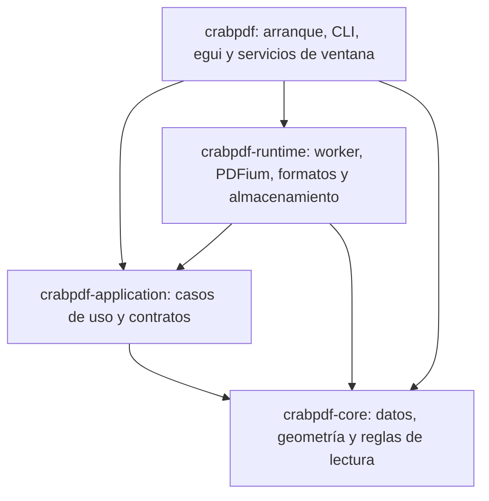

# ADR-0001: monolito modular con puertos y adaptadores

- Fecha: 23 de octubre de 2026.
- Estado: implementado en cuatro paquetes; validación y límites en [PHASE_6](../architecture/PHASE_6.md).
- Base inspeccionada: CrabPDF 0.3.6, commit `3516ac91fc39c278a2c0ce19a3d85e01de761541`.
- Ejecución: [plan de migración](../ARCHITECTURE_MIGRATION.md).
- Alcance: organización y límites del código; se conserva el alcance de [V1 y V2](../ROADMAP.md).

## Contexto

CrabPDF combina una interfaz inmediata egui/eframe, PDFium, conversores locales de formatos, cachés CPU/GPU, búsquedas progresivas, marcas persistentes y perfiles compartidos por varias ventanas. Debe seguir siendo ligero en Windows x86/x64 y funcionar en Linux y macOS. V1 exige paridad funcional con la referencia fijada de SumatraPDF; los plugins Rust/Wasm pertenecen a V2.

La separación existente es aprovechable: `document.rs`, `layout.rs` y `reading_position.rs` no importan egui ni PDFium; el worker mantiene documentos nativos en su hilo. El problema está en las responsabilidades superpuestas: `ReaderApp` crea servicios, conserva estados de negocio y visuales, despacha acciones, procesa resultados y decide cuándo persistir. `formats.rs` reúne conversión, procesos, bloqueos y caché; `config.rs` mezcla modelos con disco e hilos. Las líneas por archivo son una señal de concentración, no una medida de calidad o rendimiento.

## Opciones evaluadas

Evaluación cualitativa propia a partir del código inspeccionado; no es un benchmark ni una clasificación universal.

| Opción | Encaje con CrabPDF | Coste y límite | Decisión |
| --- | --- | --- | --- |
| Dividir los archivos actuales conservando todas las dependencias | Reduce tamaño de archivos y riesgo inmediato | No evita que navegación y almacenamiento sigan dependiendo de la UI | Paso inicial útil, insuficiente como destino |
| MVC/MVVM como estructura principal | Ayuda a organizar presentación | No resuelve por sí mismo propietarios nativos, importación, revisiones y persistencia; un ViewModel gigante repetiría el problema | Aplicable a vistas concretas, no como arquitectura completa |
| Clean/hexagonal estricta con múltiples interfaces y DTO por operación | Separa lógica y mecanismos | Demasiada ceremonia si cada acción crea capas, conversiones y abstracciones sin uso real | Adoptar sus límites, limitar su maquinaria |
| ECS, bus global de eventos o servicios separados | Ofrece extensibilidad | Añade enrutamiento y ciclos de vida innecesarios; no hay evidencia de que resuelva los problemas observados | Descartada para esta migración |
| Monolito modular con puertos/adaptadores y actualización explícita de estado | Conserva binario y tecnologías; aísla reglas, efectos y detalles nativos | Requiere cortar dependencias reales y comprobar orden de eventos | Seleccionada |

## Decisión

Mantener un único producto de escritorio y organizarlo por responsabilidades y funciones. El núcleo describe documentos y geometría; la aplicación decide qué hacer; los adaptadores ejecutan I/O; la interfaz presenta el estado y traduce entradas. Los puertos son conversaciones pequeñas y tipadas, principalmente solicitudes/resultados asíncronos. Se introducen traits solamente donde permitan sustituir un servicio o una prueba útil.

La arquitectura de puertos y adaptadores permite probar la aplicación separada de dispositivos y almacenamiento. La selección de este patrón para CrabPDF es nuestra inferencia a partir de las dependencias observadas. [Artículo original de Alistair Cockburn](https://alistair.cockburn.us/hexagonal-architecture).

### Límites y dependencias

Destino físico de cuatro paquetes, alcanzado después de separar módulos dentro del paquete actual:

Las flechas indican dependencias de compilación. Los resultados del runtime regresan a la aplicación mediante tipos definidos por la aplicación; no existe una dependencia inversa. El paquete raíz conserva el nombre `crabpdf`, el ejecutable, `build.rs`, los recursos, ejemplos y pruebas de integración. Los paquetes internos empiezan con `publish = false`.

Un workspace permite compartir lockfile, perfiles y comandos de comprobación. Es el mecanismo de Cargo elegido para hacer exigibles los límites una vez extraídos; por sí mismo no garantiza menor memoria, compilación más rápida ni binarios menores. [Cargo: workspaces](https://doc.rust-lang.org/cargo/reference/workspaces.html).

### Propiedad del estado

| Propietario | Datos y decisiones |
| --- | --- |
| Core | Coordenadas, posiciones de lectura, claves de render, contenido textual, marcas y errores independientes del SDK |
| Aplicación | Pestañas lógicas, navegación/historial, búsqueda y su generación, selección lógica, favoritos, sesión y decisiones de guardado |
| Runtime | Documentos PDFium, colas, procesos conversores, caché CPU, archivos preparados, bloqueos y escritura atómica |
| Desktop/UI | Texturas GPU, rectángulos egui, foco, arrastres, animaciones, viewport físico, menús, diálogos nativos y estado de ventana |

Cada dato tiene un propietario. La UI conserva estado visual de pestaña; no una segunda copia de la sesión de negocio. Los modelos de lectura expuestos a las vistas son referencias o proyecciones pequeñas; no se clonan documentos, perfiles o buffers por frame.

### Flujo de actualización

Entradas de teclado, menú, CLI y pruebas se traducen al mismo vocabulario de acciones de aplicación. El controlador modifica estado y produce efectos tipados. El ejecutor envía trabajo al worker o al escritor de preferencias; sus resultados vuelven como eventos. La UI solicita repintado cuando cambia algo o hay una animación activa.

Se adopta este flujo para las operaciones con efectos; los widgets conservan el estilo inmediato de egui. No se obliga a convertir cada hover o campo local en un mensaje. [Documentación de egui 0.36.2](https://docs.rs/egui/0.36.2/egui/). La separación entre estado, interacciones y vista también puede estudiarse en [la arquitectura de Iced](https://book.iced.rs/architecture.html); no implica cambiar de framework.

### Restricciones de ejecución

PDFium y sus handles permanecen en un único hilo propietario. No se envían handles a la UI ni se promete paralelismo por activar `thread_safe`: el proyecto documenta que sus llamadas se serializan. Conversión y escritura conservan sus trabajadores independientes. [pdfium-render: multithreading](https://github.com/ajrcarey/pdfium-render/blob/master/README.md#multi-threading).

Se conservan prioridad de páginas visibles, límites de memoria por arquitectura, descarte de resultados obsoletos, render por regiones y ausencia de I/O bloqueante en el frame. El plan amplía los contratos de identidad/revisión donde sea necesario y hace explícitos cierre y cancelación; no intenta interrumpir una llamada PDFium en curso.

### Persistencia y compatibilidad

Mover módulos no cambia rutas de perfil, variables de entorno, formato TOML, firma de documentos preparados, caché v4 ni esquema 2 de marcas. La extracción de tipos usa reexportaciones para conservar identidad y compatibilidad de consumidores. Cualquier cambio posterior de identidad o esquema tiene una migración y pruebas propias.

Los textos traducibles describen propiedades; no controlan permisos, conteos ni decisiones. Se reutilizan primero `DocumentDetails.title`, `annotation_count` y `annotation_warning`, que ya existen pero no son consumidos sistemáticamente. Las capacidades de operaciones futuras se añaden cuando haya un consumidor real.

### Extensión futura

Impresión, formularios, operaciones PDF y SyncTeX deben entrar por servicios específicos de aplicación y adaptadores de plataforma cuando se implementen sus rutas V1. No se crean carpetas o interfaces vacías para simular esas funciones.

V2 podrá incorporar un host opcional de plugins que invoque servicios delimitados. Esta decisión no define ABI de plugins nativos, carga dinámica, WIT ni runtime Wasm; tampoco expone estado mutable, handles nativos o acceso indiscriminado al perfil.

## Consecuencias y límites

La principal mejora esperada es poder comprobar favoritos, navegación, sesiones y eventos tardíos sin abrir una ventana ni cargar PDFium. Los adaptadores siguen necesitando pruebas reales de motor, disco, procesos y geometría nativa.

Se añaden manifiestos y límites de API que habrá que mantener. Separar paquetes no elimina los riesgos de los conversores, no corrige automáticamente bugs y no completa la paridad V1. La mejora de rendimiento debe medirse; la prioridad es conservar comportamiento y reducir el coste de cambios futuros.

La migración conserva una fachada pública de reexportaciones para consumidores del desktop; usa y cortes pequeños, con una implementación activa por funcionalidad. El enfoque gradual está respaldado por [Branch by Abstraction, Martin Fowler](https://martinfowler.com/bliki/BranchByAbstraction.html). No se duplican escrituras a perfiles o marcas para comparar implementaciones.

## Reconsiderar esta decisión si

- Las mediciones muestran que un límite concreto exige copias o latencia significativas: corregir el contrato antes de añadir servicios o hilos.
- Un segundo motor real requiere una abstracción diferente: adaptar el puerto a operaciones utilizadas, no a todo PDFium.
- Una necesidad confirmada exige aislamiento de procesos: evaluarlo en un ADR aparte con costes de memoria, arranque y recuperación.
- La división física de un módulo no aporta independencia comprobable: mantenerlo como módulo interno y registrar el motivo.
